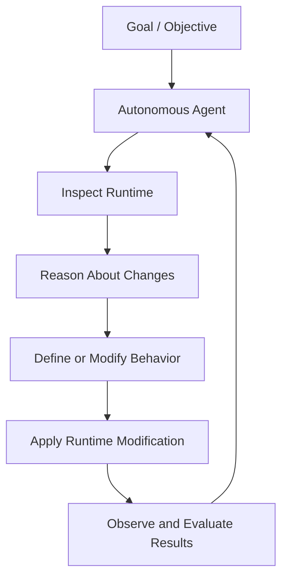
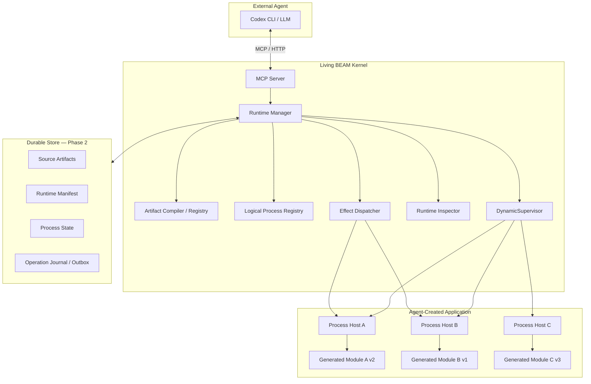
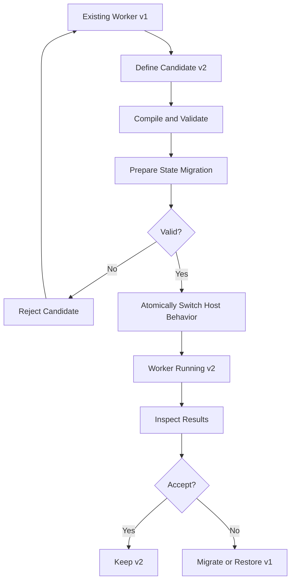
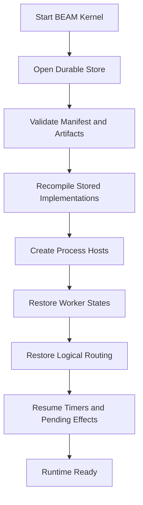

# Living BEAM — Architecture & Implementation Plan

**Status:** Proposed architecture  
**Version:** 0.1  
**Implementation language:** Elixir / Erlang OTP  
**Initial agent:** OpenAI Codex CLI  
**Interface:** Model Context Protocol (MCP)  
**Initial deployment:** Local development environment  
**Long-term objective:** An autonomous, self-evolving software system

---

## 1. Executive Summary

Living BEAM is an experimental software runtime in which an AI agent can create, execute, inspect, connect, and replace running Elixir processes without following a traditional source-code-to-deployment workflow.

The system begins as a small, conventional Elixir/OTP application containing a stable runtime kernel and an MCP server.

A connected LLM, initially operating through Codex CLI, uses MCP tools to progressively construct a running application. It can introduce new behavior, create supervised processes, connect processes through messages, observe their execution, and replace implementations while the runtime remains operational.

Rather than treating source repositories, commits, pull requests, and deployment artifacts as the primary representation of software, Living BEAM treats a **dynamic graph of executable processes and their behavior as the primary application model**.

The ultimate vision is a system that can receive a high-level objective, develop software to achieve that objective, observe the results of its execution, and continuously modify itself to improve those results.

Two initial proofs of concept will establish the technical foundations:

- **Phase 1 — Live Genesis:** Demonstrate that Codex can construct and evolve a running BEAM application through MCP, without restarting the runtime.
- **Phase 2 — Durable Genesis:** Demonstrate that the resulting application can survive a complete BEAM restart, reconstructing its generated code, processes, relationships, and persistent state without LLM involvement.

These phases deliberately stop short of building a fully autonomous goal-seeking agent. Instead, they establish the execution substrate on which such an agent can eventually operate.

## 2. Vision and Design Philosophy

### 2.1 Software as a living system

Traditional software delivery follows a sequence:

1. A developer modifies source code.
2. Changes are validated through tests and review.
3. A build system produces a deployment artifact.
4. The artifact is installed into a runtime.
5. The system begins executing the new behavior.

Living BEAM explores an alternative model:

1. An agent observes an existing running system.
2. The agent identifies a capability or behavioral change it wants to introduce.
3. It defines a new implementation.
4. The runtime validates and loads the implementation.
5. Existing or new processes adopt the behavior.
6. The agent observes the result and continues iterating.

The distinction is fundamental.

A traditional application is largely constructed before execution. A Living BEAM application is progressively constructed and evolved during execution.

### 2.2 Long-term autonomous control loop

The desired eventual control loop is:



The LLM is responsible for reasoning, proposing changes, and evaluating progress.

The runtime is responsible for executing code, managing process lifecycles, enforcing operational contracts, recording changes, and recovering from failures.

These responsibilities should remain separate.

### 2.3 Guiding principles

**Runtime-first development.** The running application is the primary target for agent-generated changes.

**Small permanent kernel.** The bootstrap application should contain only infrastructure required to create, manage, observe, and eventually recover dynamically generated functionality.

**Everything has a logical identity.** Processes are addressed through stable IDs rather than transient BEAM PIDs.

**Behavior is replaceable.** An implementation can be changed independently of the logical process that uses it.

**OTP owns process lifecycle.** Generated application processes operate within a supervised environment.

**The LLM is not the recovery engine.** Restart recovery should be deterministic and should work without access to an LLM.

**Changes are observable.** The agent should be able to understand the running topology, implementation versions, state, failures, and recent operations.

**Self-evolution is incremental.** Capabilities grow through agent-generated modules and interconnected processes. Modification of the trusted kernel itself is reserved for later research.

**Recovery is designed before it is implemented.** Phase 1 interfaces must be compatible with Phase 2 persistence.

## 3. Goals and Non-Goals

### 3.1 Primary goals

The project must eventually demonstrate the ability to:

- Bootstrap an Elixir runtime with minimal application behavior.
- Expose runtime-management capabilities through MCP.
- Allow Codex to generate valid Elixir source code.
- Compile and load generated modules dynamically.
- Create supervised processes using those modules.
- Address and inspect processes through logical identifiers.
- Send messages between agent-created processes.
- Replace process behavior without restarting the BEAM.
- Preserve compatible state during behavior replacement.
- Observe runtime activity and failures.
- Persist executable definitions and desired runtime topology.
- Recover the application after a complete BEAM restart.
- Support increasingly autonomous, goal-directed evolution.

### 3.2 Initial non-goals

The two proof-of-concept phases will not attempt to implement:

- Distributed BEAM clustering.
- Production deployment.
- A general-purpose secure Elixir sandbox inside the BEAM.
- Arbitrary OTP release hot upgrades.
- Fully autonomous code review or security validation.
- Runtime modification of the bootstrap kernel.
- An embedded LLM inference engine.
- Long-running independent agent reasoning loops.
- A web-based development environment.
- Exactly-once external side-effect execution.
- Automatic discovery and installation of third-party dependencies.
- Database schema evolution generated by the agent.

These are possible future capabilities, but implementing them immediately would obscure the core experiment.

## 4. High-Level Architecture

### 4.1 Component overview



### 4.2 Runtime ownership

The Elixir runtime must run independently of Codex CLI.

Codex connects to the runtime through an existing MCP endpoint rather than launching and owning the entire runtime as a temporary subprocess.

This makes it possible to:

- Disconnect Codex without terminating active workers.
- Connect a new Codex session to an already-running application.
- Replace Codex with a different agent.
- Restart Codex independently of the application.
- Restart the BEAM and recover its durable configuration.

**Initial transport:** MCP Streamable HTTP, bound to localhost.

**Suggested development endpoint:** `http://127.0.0.1:4100/mcp`

Hermes MCP supports Streamable HTTP server transport. The implementation agent should verify the chosen Hermes version and its endpoint configuration before implementation.

The MCP server belongs to the stable Elixir kernel; it is not itself generated by the agent.

## 5. Architecture Decisions

### ADR-001: Elixir and the BEAM as the execution substrate

**Decision:** Use Elixir and Erlang/OTP for the kernel and agent-generated execution environment.

**Rationale:**

The BEAM provides several capabilities particularly relevant to this experiment:

- Lightweight, independently scheduled processes.
- Message-passing concurrency.
- Process supervision.
- Runtime module loading.
- Long-lived stateful processes.
- Failure monitoring and recovery.
- A mature process-introspection environment.

These properties make it possible to manipulate application behavior at a finer granularity than conventional application deployments.

**Tradeoffs:**

The BEAM is not a security sandbox. Dynamically compiled code executes with the privileges of the VM.

Generated code also introduces challenges relating to module lifetime, memory usage, dependencies, and state migrations.

### ADR-002: MCP as the agent-control protocol

**Decision:** Expose runtime capabilities as MCP tools.

**Rationale:**

MCP decouples the runtime from any specific LLM vendor or agent framework.

Codex CLI will be the first client, but future clients could include other coding agents or a native Elixir agent.

An MCP-based interface also makes the agent's actions explicit, inspectable, and independently testable.

**Implementation:** Prefer the `hermes_mcp` Elixir library.

**Tradeoff:** MCP is a control interface, not a workflow or execution engine. The runtime must implement its own state management and process orchestration.

### ADR-003: Stable process hosts with replaceable implementations

**Decision:** Use a permanent `GenServer` process-host implementation that delegates application behavior to dynamically generated modules.

The agent does not initially create arbitrary top-level OTP process implementations directly.

Instead, each generated behavior module conforms to a small contract understood by the process host.

**Rationale:**

This separates process identity and lifecycle from implementation.

The kernel controls supervision, routing, state retention, and implementation changes.

A process can adopt a new behavior module while retaining its PID and mailbox.

This also simplifies state migration and future persistence.

**Tradeoff:** The first version will not support every possible OTP programming pattern. Generated behavior runs through a constrained interface rather than owning an entire GenServer lifecycle.

The contract is an organizational boundary, not a security boundary: dynamically compiled code can still call arbitrary Elixir functions unless isolated at the operating-system level.

### ADR-004: Versioned generated modules instead of native hot-code replacement

**Decision:** Each generated implementation revision receives a distinct module name.

Example:

```elixir
LivingBeam.Generated.Counter.V1
LivingBeam.Generated.Counter.V2
LivingBeam.Generated.Counter.V3
```

The actual implementation should use collision-resistant, validated revision identifiers rather than trusting arbitrary module names supplied by the LLM.

**Rationale:**

The BEAM supports code replacement, but native OTP upgrades introduce additional complexity around old code, process state, and module purging.

Versioned modules allow the old and new implementations to coexist.

A process host can select a new implementation through ordinary function dispatch.

This provides a simpler foundation for staged upgrades and rollback.

**Tradeoffs:**

Loaded modules and their atoms consume VM resources. They cannot be treated as an unlimited garbage-collected collection.

The kernel must bound generated code volume, versions, and module creation. Long-lived systems will eventually require a policy for retiring versions and restarting executor nodes to reclaim resources.

Native `code_change/3` upgrades can be investigated separately.

### ADR-005: Centralized runtime management

**Decision:** All runtime modifications pass through a single `Runtime.Manager` interface.

The MCP layer must not independently compile modules, start children, or mutate runtime metadata.

**Rationale:**

This creates one authoritative location for validation, sequencing, observability, and eventual persistence.

It also makes it easier to implement idempotency, concurrent-update protection, and deterministic recovery.

**Tradeoff:** Runtime mutation coordination becomes centralized. This is acceptable for a single-node proof of concept.

### ADR-006: The process graph is the application manifest

**Decision:** Represent the application as a collection of logical workers, implementation references, configuration, and relationships.

The manifest is the desired configuration of the application.

The process registry and running PIDs are its live realization.

**Rationale:**

An agent should be able to inspect and manipulate the application's topology without relying on file paths or source-code project organization.

The same representation can later be persisted and used for recovery.

**Tradeoff:** The manifest must be kept consistent with actual running processes, especially during failures or interrupted transitions.

### ADR-007: External LLM reasoning for initial phases

**Decision:** Codex CLI operates the runtime from outside the BEAM.

**Rationale:**

The first research question is whether an LLM can build and evolve a live execution environment.

Embedding a separate agent framework inside the runtime would add complexity without helping answer that question.

The runtime should remain agent-agnostic.

**Future consideration:** A native agent built with Nous, Jido, or a custom OTP process could eventually use the same internal runtime-management API.

### ADR-008: Embedded durable storage

**Decision:** Introduce CubDB in Phase 2 as the first persistent store.

**Rationale:**

CubDB is a native Elixir embedded database supporting transactional durable storage.

The project initially requires only a single-node key-value persistence model.

It does not need a separate PostgreSQL service.

The storage layer must remain behind an application-level interface so that SQLite or another backend can be introduced later.

### ADR-009: An immutable-by-contract kernel

**Decision:** The agent-generated application can evolve, but the bootstrap kernel is not an authorized self-modification target during the first two phases.

**Rationale:**

The manager, compiler, protocol server, and recovery logic need stable contracts.

Allowing the system to rewrite its control infrastructure immediately would make failures difficult to isolate and recovery difficult to reason about.

**Limitation:** This is not enforceable isolation when the kernel and generated code run in the same VM. True protection requires a separate executor boundary.

The initial whole-runtime environment must therefore be disposable and isolated from sensitive host resources.

## 6. Core Components

### 6.1 MCP Server

**Responsibility:** Translate MCP tool requests into calls to the runtime manager and return structured results.

It must:

- Advertise a stable collection of tools.
- Validate input schemas.
- Return clear success and error results.
- Support Codex CLI over Streamable HTTP.
- Expose useful runtime descriptions to the agent.
- Avoid leaking raw exception traces containing sensitive information.
- Remain available after individual worker failures.

Do not use the MCP server process to directly execute generated behavior.

### 6.2 Runtime Manager

**Responsibility:** Authoritative orchestration of the evolving runtime.

It maintains:

- Logical worker definitions.
- Active implementation references.
- Worker lifecycle status.
- Runtime generation/revision metadata.
- Pending and completed operations.
- Artifact references.
- Runtime topology.

All mutating operations are serialized or protected by optimistic revision checks.

Phase 1 stores this metadata in memory.

Phase 2 persists the desired state transactionally.

### 6.3 Artifact Compiler and Registry

**Responsibility:** Accept source code, validate metadata, compile the implementation, and register immutable revisions.

The compiler must:

1. Accept source code and a logical behavior name.
2. Assign a unique version identifier.
3. Verify source size and module-count limits.
4. Compile the source in the experimental runtime.
5. Capture compilation errors and warnings.
6. Verify the expected callback contract.
7. Register the compiled artifact with its source and hash.
8. Make successful artifacts available for process creation or replacement.

Compilation should not automatically activate an implementation.

**Important:** Compilation is not safe merely because it is performed in a separate Elixir Task. The compiler must run inside the disposable execution environment.

### 6.4 Process Host

**Responsibility:** Provide stable OTP lifecycle management while delegating behavior to a generated implementation.

Illustrative process-host state:

```elixir
%{
  id: "counter",
  implementation: LivingBeam.Generated.Counter.V2,
  implementation_version: 2,
  data: %{"count" => 42},
  status: :running
}
```

The process host is a conventional kernel-owned `GenServer`.

Generated modules implement a behavior such as:

```elixir
defmodule LivingBeam.Behavior do
  @callback init(config :: map()) ::
              {:ok, state :: map()}

  @callback handle_event(event :: map(), state :: map()) ::
              {:ok, reply :: term(), new_state :: map(), effects :: list()}
              | {:error, reason :: term()}

  @callback migrate(old_state :: map(), metadata :: map()) ::
              {:ok, new_state :: map()}
              | {:error, reason :: term()}
end
```

`migrate/2` is optional when the implementation explicitly declares compatibility with the existing state schema.

The process host controls:

- Process startup.
- Event dispatch.
- State transitions.
- Implementation switching.
- State migration.
- Failure reporting.
- Supervision and restart behavior.

Generated behavior should be written as state-transition logic. The kernel executes supported effects after a successful transition.

### 6.5 Logical Process Registry

**Responsibility:** Resolve stable logical IDs to current process instances.

Use Elixir's `Registry`.

Example:

```text
"counter"       -> PID A
"aggregator"    -> PID B
"notification"  -> PID C
```

Generated modules communicate through logical IDs rather than storing other workers' PIDs.

A process can restart without forcing every other worker to update its references.

The registry is reconstructed automatically when workers restart.

### 6.6 Effect Dispatcher

**Responsibility:** Handle effects requested by agent-generated behavior.

Initial supported effects:

- Emit an event to another logical worker.
- Schedule an event after a delay.
- Record a structured log event.

Example:

```elixir
%{
  "type" => "emit",
  "to" => "aggregator",
  "event" => %{"value" => 42}
}
```

The effect dispatcher resolves logical destinations and handles delivery.

This allows generated modules to focus on behavior rather than implementing message routing themselves.

In Phase 2, pending effects and timers become part of the durable runtime state.

Only effects implemented by the kernel can receive durability guarantees. Generated code that performs its own network calls, file writes, or operating-system operations is outside those guarantees.

### 6.7 Runtime Inspector

**Responsibility:** Expose a useful representation of the running application to the agent.

It should provide:

- Running and stopped workers.
- Logical IDs and current PIDs.
- Active implementation revisions.
- Worker state, subject to size limits.
- Process status and restart counts.
- Pending scheduled actions.
- Recent events and failures.
- Relationships between workers.
- Current runtime generation.

Inspecting the runtime should not require access to the BEAM shell.

## 7. MCP Tool Contract

The initial MCP API should be small and consistent.

| Tool | Purpose |
|---|---|
| `runtime_define` | Compile and register a generated implementation |
| `runtime_start` | Start a new supervised logical worker |
| `runtime_replace` | Change a worker's implementation |
| `runtime_invoke` | Deliver an event to a logical worker |
| `runtime_inspect` | Inspect the runtime or a worker |
| `runtime_stop` | Stop a logical worker |
| `runtime_events` | Retrieve recent runtime events and failures |

### 7.1 `runtime_define`

Inputs:

- `logical_name`: Human-readable behavior name.
- `source`: Elixir source.
- `expected_behavior`: Supported callback contract.
- `request_id`: Client-generated operation identifier.

Returns:

- Artifact ID.
- Generated module name.
- Source hash.
- Compilation status.
- Compilation diagnostics.
- Exported callback validation result.

The artifact is inactive until assigned to a worker.

### 7.2 `runtime_start`

Inputs:

- `worker_id`: Stable logical identifier.
- `artifact_id`: Implementation to run.
- `config`: Initialization arguments.
- `request_id`: Idempotency identifier.

Returns:

- Logical worker ID.
- PID, for diagnostic purposes.
- Implementation version.
- Current lifecycle status.

A duplicate active logical ID must not silently create another worker.

### 7.3 `runtime_replace`

Inputs:

- `worker_id`.
- `artifact_id`.
- `expected_revision`.
- `request_id`.

Returns:

- Previous implementation revision.
- New implementation revision.
- Migration result.
- Worker PID before and after replacement.
- New runtime generation.

Replacement semantics:

1. Confirm the target worker exists.
2. Validate the candidate artifact.
3. Reject stale expected revisions.
4. Validate or migrate the current state.
5. Switch the implementation reference.
6. Retain the current PID and mailbox.
7. Report success.

If migration fails, the previous implementation and state remain active.

The first version must not attempt an in-place native OTP code upgrade.

### 7.4 `runtime_invoke`

Inputs:

- `worker_id`.
- `event`: Structured input.
- `request_id`.

Returns:

- Reply.
- Worker revision.
- State revision.
- Any useful effect acknowledgements.

The event is delivered through the process host.

### 7.5 `runtime_inspect`

Inputs:

- Optional `worker_id`.
- Requested detail level.

Returns a structured view of workers, implementations, state, and runtime health.

When no worker is specified, return the runtime topology.

### 7.6 `runtime_stop`

Stops a logical worker and updates its desired status.

The tool must distinguish stopping a worker from deleting its persisted definition.

### 7.7 `runtime_events`

Returns recent lifecycle events, errors, implementation replacements, and messages needed for debugging.

Include sequence numbers or cursors so a client can retrieve events incrementally.

### Common API rules

All mutating operations should include a request ID.

Errors should use stable machine-readable codes, such as `WORKER_NOT_FOUND`, `COMPILE_FAILED`, `MIGRATION_FAILED`, and `REVISION_CONFLICT`.

Tool responses should be bounded in size.

The API should be versioned so later runtime changes do not break existing clients.

## 8. Runtime Replacement Protocol

Behavior replacement is the central experiment.

### 8.1 Replacement state machine



### 8.2 Required properties

- The old implementation remains available until replacement succeeds.
- The process host retains its logical identity.
- The normal replacement path preserves the PID and mailbox.
- State migration is explicit when schemas change.
- A failed migration leaves the previous implementation active.
- Events are processed sequentially by the host during replacement.
- Replacement operations are observable.
- The kernel must not claim successful replacement until the active implementation is confirmed.

Rollback should be an explicit operation, not an assumption that switching module references automatically reverses a state migration.

If state has already changed under the new implementation, restoring the old implementation may require a reverse migration or an earlier checkpoint.

### 8.3 Failure boundaries

For Phase 1, replacement is atomic with respect to the individual process host's state transition while that host remains alive.

It is not a transactional guarantee against BEAM crashes or arbitrary effects executed by generated code.

Phase 2 adds a durable commit boundary.

## 9. Phase 1 — Live Genesis

### 9.1 Objective

Demonstrate that Codex CLI can build, operate, and modify a live Elixir application exclusively through MCP runtime-management tools.

The system starts with no prewritten domain application.

### 9.2 Deliverables

- A bootable Elixir/OTP application.
- An independently running, localhost MCP server.
- A `DynamicSupervisor`.
- A logical process registry.
- A process-host abstraction.
- A runtime manager.
- A dynamic artifact compiler.
- A replaceable behavior contract.
- An effect dispatcher.
- Runtime inspection and event reporting.
- A working Codex CLI MCP connection.
- Automated ExUnit tests and an end-to-end demonstration.

Persistence is not required in this phase.

### 9.3 Recommended demonstration

Have Codex build a small live event-processing system.

**Step 1 — Create a counter**

Tell Codex:

> Create a worker named `counter` that maintains an integer count. It should accept an increment event and return its current count.

Codex generates an Elixir module, compiles it through `runtime_define`, and launches a worker through `runtime_start`.

It invokes events and confirms the state changes.

**Step 2 — Add another process**

Tell Codex:

> Create a second worker named `aggregator`. Modify the counter so that every increment also sends an event to the aggregator. The aggregator should track the number of received events and their total value.

Codex creates the second module and worker.

It replaces the counter's behavior and establishes communication through logical IDs and the kernel effect dispatcher.

**Step 3 — Modify the live application**

Tell Codex:

> Change the counter so it can increment by an arbitrary positive amount. Preserve its current count and keep the existing process running.

Codex creates a new implementation revision, tests the candidate, and uses `runtime_replace`.

**Step 4 — Observe and debug**

Ask Codex to inspect the runtime, verify both workers, exercise their interaction, and correct any implementation errors.

The expected result is a working application created and modified without changing the kernel's source files or restarting the BEAM.

### 9.4 Acceptance criteria

- [ ] Codex connects to the running runtime through MCP.
- [ ] Codex creates a valid generated module using an MCP tool.
- [ ] The runtime compiles and loads the module.
- [ ] A supervised worker starts with a logical ID.
- [ ] Codex can invoke the worker and inspect its state.
- [ ] Codex creates a second worker and connects the two.
- [ ] A generated implementation is replaced while running.
- [ ] The target worker retains its PID across normal replacement.
- [ ] State is preserved or explicitly migrated.
- [ ] Failed compilation does not alter the active implementation.
- [ ] Failed migration does not corrupt the existing worker.
- [ ] Crashing one worker does not terminate the MCP server.
- [ ] Codex can disconnect and reconnect while the runtime remains alive.
- [ ] The entire demonstration runs locally.

### 9.5 Phase 1 completion definition

Phase 1 succeeds when a fresh Codex session can connect to a nearly empty runtime and construct a functioning multi-process application, modify it in place, inspect its behavior, and recover from ordinary worker-level errors.

The runtime remains alive throughout the demonstration.

## 10. Phase 2 — Durable Genesis

### 10.1 Objective

Make the agent-created application recoverable after a complete BEAM VM restart, without requiring Codex or any other LLM to reconstruct it.

The key distinction is between preserving a process and preserving the information necessary to recreate that process.

PIDs, mailbox contents, monitors, and active timers cannot simply be serialized and resumed as if the VM never stopped.

Recovery must recreate processes from stable definitions and explicitly restore recoverable application state.

### 10.2 Persistent runtime model

Persist four primary categories of information.

**A. Artifacts**

Store:

- Generated source code.
- Logical behavior name.
- Artifact identifier and revision.
- Source hash.
- Module identity.
- Behavior contract version.
- Optional state schema version.
- Compilation metadata.

**B. Runtime manifest**

Store:

- Logical worker IDs.
- Active artifact references.
- Desired worker statuses.
- Initialization configuration.
- Worker revision numbers.
- Relationships and configuration required to reconstruct the graph.

**C. Worker state**

Store:

- Logical worker ID.
- State schema version.
- Last committed serializable state.
- State revision.
- Checkpoint metadata.

**D. Operation journal and pending effects**

Store:

- Runtime mutations and outcomes.
- Idempotency keys.
- Durable event and operation identifiers.
- Pending scheduled actions.
- Pending effect deliveries.
- Delivery or completion status.

The journal is initially an audit record and recovery aid; the latest committed manifest and state are authoritative. Full event-sourced reconstruction is not required.

### 10.3 State serialization contract

For the proof of concept, persisted worker state should be restricted to bounded, JSON-compatible structures.

Do not attempt to persist:

- PIDs.
- Process references.
- Ports.
- Anonymous functions.
- Open file handles.
- Live network connections.
- Arbitrary resource handles.

Generated modules must explicitly reconstruct runtime-only resources when necessary.

Use state schema versions and migration callbacks to accommodate evolving state representations.

### 10.4 Suggested persistent manifest

Illustrative format:

```json
{
  "schema_version": 1,
  "generation": 12,
  "workers": {
    "counter": {
      "artifact_id": "counter-v3",
      "desired_status": "running",
      "config": {},
      "state_schema": 2,
      "state_revision": 48,
      "worker_revision": 3
    },
    "aggregator": {
      "artifact_id": "aggregator-v1",
      "desired_status": "running",
      "config": {},
      "state_schema": 1,
      "state_revision": 16,
      "worker_revision": 1
    }
  }
}
```

Actual state is stored separately and associated with the logical worker ID and revision.

### 10.5 Persistence consistency model

Persistence needs stronger guarantees than occasional background snapshots.

For Phase 2:

1. Persist new artifacts before they can become active.
2. Atomically commit manifest changes that select new implementations.
3. Persist each accepted state transition before acknowledging success.
4. Store any kernel-managed effects or timers in the same transaction as their originating state transition.
5. Dispatch committed effects from a durable pending-effects queue.
6. Use operation IDs and deduplication to make retries safe.

This establishes a durable boundary for state transitions performed through the kernel.

External side effects remain at-least-once unless their recipients support idempotency. Exactly-once delivery is not a Phase 2 objective.

### 10.6 Restart recovery sequence



Detailed procedure:

1. Boot the conventional OTP kernel.
2. Open the persistent store.
3. Read the latest committed manifest.
4. Validate artifact references and source hashes.
5. Compile the required implementation modules.
6. Start the dynamic supervisor and registry.
7. Recreate desired running workers with their stable logical IDs.
8. Inject the last committed state into each worker.
9. Reestablish runtime-managed relationships and scheduled work.
10. Resume pending effects using their durable identifiers.
11. Expose recovery results through the inspector.
12. Make the runtime available for normal operations.

Recovery should be deterministic and should not require the agent to reason about what to restore.

### 10.7 Recovery failure handling

The recovery engine must distinguish an invalid or unrecoverable worker from a failure of the entire kernel.

If an artifact cannot be compiled or state migration fails:

- Mark the affected worker as failed or quarantined.
- Record diagnostics.
- Continue recovering unrelated workers when safe.
- Preserve the stored artifact and state for investigation.
- Avoid repeatedly crashing the entire application.

A broken generated application must not make its durable description impossible to inspect.

### 10.8 Phase 2 demonstration

1. Start Living BEAM with an empty durable store.
2. Connect Codex CLI.
3. Have Codex recreate the Phase 1 counter and aggregator system.
4. Send enough events to accumulate meaningful state.
5. Ask Codex to replace the counter implementation.
6. Confirm the new behavior and retained state.
7. Disconnect Codex.
8. Abruptly terminate the entire BEAM VM.
9. Restart Living BEAM using the same persistent store, without Codex.
10. Verify that all intended workers are reconstructed.
11. Verify that active implementation revisions are correct.
12. Verify restored counter and aggregator state.
13. Verify that new events can be processed.
14. Verify that durable timers and effects resume according to their specified delivery semantics.
15. Reconnect Codex and continue evolving the recovered application.

### 10.9 Acceptance criteria

- [ ] Generated source artifacts survive VM termination.
- [ ] The desired runtime manifest survives VM termination.
- [ ] Active implementation selections survive VM termination.
- [ ] Committed process state survives VM termination.
- [ ] Logical worker identities are retained.
- [ ] Worker PIDs are recreated rather than assumed persistent.
- [ ] The runtime restores itself without connecting to an LLM.
- [ ] Previously committed mutations are not partially applied.
- [ ] Incomplete operations are safely rejected, resumed, or reconciled.
- [ ] Durable timers and pending effects are recovered.
- [ ] Repeated event delivery does not duplicate committed state transitions.
- [ ] An invalid worker is quarantined without preventing unrelated recovery.
- [ ] Codex can reconnect and modify the restored runtime.
- [ ] Recovery tests pass after abrupt VM termination, not just graceful shutdown.

### 10.10 Phase 2 completion definition

Phase 2 succeeds when the runtime can be terminated without warning and restarted from its persistent storage, reconstructing a previously agent-generated application and resuming operation from the last committed recoverable state.

## 11. Supervision and Lifecycle Design

The proposed OTP supervision structure is:

```text
LivingBeam.Application
|
+-- Runtime.Store                  (Phase 2)
+-- Runtime.ArtifactRegistry
+-- Runtime.ProcessRegistry
+-- Runtime.EventLog
+-- Runtime.EffectDispatcher
+-- Runtime.WorkerSupervisor
|   |
|   +-- Runtime.ProcessHost [counter]
|   +-- Runtime.ProcessHost [aggregator]
|   +-- Runtime.ProcessHost [...]
|
+-- Runtime.Manager
+-- Runtime.MCPServer
```

Actual startup dependencies should determine the final supervision order.

Important lifecycle requirements:

- Worker failures must be isolated from the MCP server.
- The manager should be able to detect unexpected worker termination.
- Restart policies must prevent infinite crash loops.
- Worker restart attempts should be bounded.
- Recovery of a generated worker must use the kernel's controlled startup path.
- The kernel must distinguish desired stopped state from unexpected failure.
- Active process state must not depend on retaining a Codex session.

The application supervisor and dynamic worker supervisor are part of the stable kernel.

## 12. Security and Resource Isolation

### 12.1 Threat model

The project intentionally executes LLM-generated Elixir code.

This is equivalent to executing untrusted programs with the privileges granted to the execution environment.

Elixir processes and supervisors provide fault isolation, not a security boundary.

An arbitrary generated module may access the file system, environment variables, network, or OS capabilities available to the VM.

Even compile-time execution must be treated as potentially unsafe.

### 12.2 Initial development strategy

Run the experimental BEAM environment inside a disposable local container or similarly isolated VM.

Recommended restrictions:

- No production credentials.
- No sensitive host directory mounts.
- A dedicated writable workspace or data volume.
- Memory and CPU limits.
- Restricted network access.
- MCP access restricted to localhost.
- No unnecessary privileged container capabilities.
- No unrestricted access to Docker or host management sockets.

The persistence volume introduced in Phase 2 must be explicitly retained across container or VM restarts.

Keep the Codex session and generated-code execution environment logically separate.

### 12.3 Future security architecture

A later version should separate the trusted control plane and the untrusted execution plane into different OS processes or BEAM nodes, with an authenticated and restricted communication interface.

This is a necessary architectural direction before exposing the runtime to remote agents or valuable infrastructure.

Distributed Erlang connectivity by itself must not be treated as a secure isolation mechanism.

### 12.4 Resource controls

Add initial limits for:

- Maximum generated source size.
- Maximum worker count.
- Maximum compiled revision count.
- Maximum state payload size.
- Maximum event payload size.
- Maximum event processing time.
- Maximum pending effects and timers.
- Maximum tool response size.

A timeout does not guarantee termination of arbitrary untrusted code. Stronger execution guarantees require process or container isolation.

## 13. Observability

Observability should be available from Phase 1.

The agent needs feedback to diagnose problems and make improvements.

### 13.1 Required lifecycle events

Record at least:

- Artifact compiled.
- Compilation failed.
- Worker created.
- Worker started.
- Worker stopped.
- Worker crashed.
- Worker restarted.
- Event delivered.
- Implementation replaced.
- Migration failed.
- Effect scheduled.
- Effect failed.
- Recovery started.
- Recovery completed.

### 13.2 Event structure

Each event should include:

- Timestamp.
- Event type.
- Logical worker ID, where applicable.
- Artifact version, where applicable.
- Correlation or request ID.
- Outcome.
- Bounded diagnostic metadata.

### 13.3 Runtime topology

The inspector should be able to produce a machine-readable graph of workers and communication relationships.

This is important for the long-term goal of autonomous structural evolution.

The agent should be able to answer questions such as:

- What processes exist?
- Which behaviors are currently active?
- Which workers exchange events?
- Which workers have failed recently?
- Which processes are accumulating state?
- What changed between runtime generations?

Future versions may present the graph visually, but structured MCP output is sufficient initially.

## 14. Recommended Technology Stack

| Concern | Technology | Reason |
|---|---|---|
| Language | Elixir | Native access to OTP and BEAM runtime capabilities |
| Runtime | Erlang/OTP | Lightweight processes, messaging, supervision |
| MCP server | Hermes MCP | Elixir-native MCP implementation |
| Initial AI client | Codex CLI | Existing agent with MCP support |
| Process orchestration | DynamicSupervisor | Runtime child creation and supervision |
| Logical addressing | Registry | Stable process lookup |
| Behavior execution | GenServer | Stateful process-host implementation |
| Dynamic compilation | `Code.compile_string/2` | Runtime source compilation |
| Event reporting | Logger + Telemetry | Structured diagnostics and instrumentation |
| Serialization | Jason | Portable JSON-compatible state |
| Persistence, Phase 2 | CubDB | Embedded durable transactional storage |
| Testing | ExUnit | Native Elixir testing |
| Local isolation | Container or disposable VM | Limit impact of generated code |

Avoid introducing LangChain, Jido, Nous, Broadway, Oban, Phoenix LiveView, or distributed clustering unless a concrete requirement emerges.

The important experiment is the runtime itself, not the surrounding framework ecosystem.

## 15. Suggested Project Structure

```text
living_beam/
├── mix.exs
├── mix.lock
├── README.md
├── ARCHITECTURE.md
├── AGENTS.md
├── config/
│   ├── config.exs
│   └── runtime.exs
├── lib/
│   ├── living_beam/
│   │   ├── application.ex
│   │   ├── behavior.ex
│   │   ├── runtime/
│   │   │   ├── manager.ex
│   │   │   ├── artifact_registry.ex
│   │   │   ├── compiler.ex
│   │   │   ├── process_host.ex
│   │   │   ├── process_registry.ex
│   │   │   ├── worker_supervisor.ex
│   │   │   ├── effect_dispatcher.ex
│   │   │   ├── inspector.ex
│   │   │   ├── event_log.ex
│   │   │   ├── manifest.ex
│   │   │   ├── store.ex
│   │   │   └── recovery.ex
│   │   └── mcp/
│   │       ├── server.ex
│   │       └── tools/
│   └── living_beam.ex
├── test/
│   ├── runtime/
│   ├── mcp/
│   ├── integration/
│   └── support/
└── examples/
    ├── phase_1_demo.md
    └── phase_2_recovery.md
```

Not every file needs to exist in Phase 1.

The implementation should remain minimal and add components as they become necessary.

Generated behavior source must not require writing files into the conventional application source tree.

Source files under `lib/` belong to the stable kernel. Agent-generated behavior belongs to the runtime artifact registry.

## 16. Local Development With Codex CLI

There are two distinct uses of Codex in this project.

### 16.1 Codex as the build agent

Codex first implements the Living BEAM kernel in a conventional local repository.

It is allowed to create source files, execute Mix commands, write tests, and modify the kernel during development.

This is ordinary AI-assisted software development.

### 16.2 Codex as the runtime evolution agent

After the kernel starts, Codex connects to it through MCP.

For the actual proof-of-concept demonstration, Codex must create and modify application behavior through MCP tools rather than editing kernel source files.

This separation is essential.

Otherwise, the experiment would simply demonstrate that Codex can modify an Elixir repository, rather than proving that it can construct a live application through a runtime API.

### 16.3 Local startup workflow

The build agent should implement a documented startup command for the long-lived application.

For example, during development:

```bash
mix run --no-halt
```

The runtime should expose its configured MCP endpoint and confirm readiness.

In a separate terminal, register the MCP server with Codex:

```bash
codex mcp add living_beam --url http://127.0.0.1:4100/mcp
```

Verify registration:

```bash
codex mcp list
```

Then launch Codex:

```bash
codex
```

The exact runtime startup and container networking instructions should be provided by the implementation in the README.

### 16.4 Codex agent instructions

Create a project-level `AGENTS.md` that distinguishes kernel development from runtime experimentation.

Recommended rules:

- Read `ARCHITECTURE.md` before changing architecture.
- Keep the kernel minimal.
- Prefer OTP primitives over new dependencies.
- Do not replace the process-host design with conventional deployment workflows.
- Preserve the distinction between logical process identity and implementation revision.
- Write tests for runtime mutations and failure paths.
- Do not claim a runtime modification succeeded without inspecting its result.
- During demonstration mode, create application functionality through MCP rather than editing project source.
- Treat generated Elixir as untrusted code.
- Do not connect the experimental runtime to production systems.
- Do not add a persistent LLM agent loop during Phases 1 or 2.

### 16.5 Development workflow

The build agent should work in small milestones.

After each milestone:

1. Implement the smallest working feature.
2. Add focused ExUnit tests.
3. Run the relevant tests.
4. Demonstrate the feature through the runtime API when applicable.
5. Update architecture documentation if an intentional design decision changes.
6. Continue to the next milestone.

Avoid building every subsystem before testing the first dynamically generated worker.

## 17. Implementation Milestones

### Milestone 1 — Kernel bootstrap

Create the minimal OTP application, supervision tree, MCP server, and runtime manager.

**Exit condition:** Codex can connect and request runtime status.

### Milestone 2 — Dynamic execution

Implement the behavior contract, compiler, artifact registry, process host, and dynamic supervisor.

**Exit condition:** A generated module can be compiled and executed through a supervised worker.

### Milestone 3 — Process orchestration

Implement logical addressing, event invocation, and kernel-managed effects.

**Exit condition:** Two generated workers can exchange events.

### Milestone 4 — Live evolution

Implement versioned behavior replacement, migration validation, revision checks, and failure handling.

**Exit condition:** Codex can replace a worker's implementation while preserving its PID and compatible state.

**Phase 1 complete.**

### Milestone 5 — Durable definitions

Introduce CubDB-backed artifact storage and a committed runtime manifest.

**Exit condition:** Generated implementations and desired worker definitions survive restart.

### Milestone 6 — Durable worker state

Persist state transitions and versioned state schemas.

**Exit condition:** A recovered worker resumes from its last committed state.

### Milestone 7 — Recovery and reconciliation

Implement deterministic boot recovery, pending-effect restoration, quarantine behavior, and crash-interruption tests.

**Exit condition:** The entire application survives abrupt VM termination and reconstructs itself without Codex.

**Phase 2 complete.**

## 18. Test Strategy

Testing must cover both ordinary OTP behavior and the novel agent-managed runtime behavior.

### Unit tests

- Artifact validation.
- Compiler result handling.
- Generated behavior callback validation.
- Logical worker ID validation.
- Process-host event transitions.
- State migration.
- Runtime revision conflicts.
- Effect interpretation.
- State serialization.
- Manifest validation.

### Integration tests

- MCP tool invocation.
- Worker creation.
- Worker-to-worker event delivery.
- Worker crash isolation.
- Runtime behavior replacement.
- Failed replacement rollback.
- Supervisor restarts.
- Codex reconnect behavior.
- Persistent state reconstruction.

### Failure-injection tests

- Invalid generated source.
- Compilation exceptions.
- Missing required callbacks.
- Invalid state migration.
- Generated worker exception.
- Event-processing timeout.
- Worker crash during an operation.
- VM termination between artifact preparation and activation.
- VM termination during a state transition.
- VM termination with pending effects.
- Corrupted or unavailable generated artifact.

Tests must verify both the reported outcome and the actual runtime state.

### Demonstration tests

At least one end-to-end scenario must be driven by Codex through MCP.

Phase 2 must additionally use a real OS-level abrupt termination test rather than relying exclusively on graceful application shutdown.

## 19. Architectural Risks and Mitigations

| Risk | Mitigation |
|---|---|
| Generated code compromises the host | Run in a disposable isolated environment |
| Generated code crashes the VM | Keep durable state and restart capability; later separate execution from control |
| Unbounded module creation | Cap artifacts and active revisions |
| State migration corrupts data | Validate candidate state before committing |
| Concurrent agent operations conflict | Use serialized mutations and expected revisions |
| Worker crashes break application topology | OTP supervision and logical IDs |
| Codex disconnects | Independent long-lived runtime |
| Abrupt restart loses worker state | Durable state transitions in Phase 2 |
| Incomplete runtime mutation | Transactional manifest updates |
| Duplicate effects after recovery | Durable IDs, outbox, and idempotency |
| Agent cannot understand runtime | Structured introspection and event history |
| Agent optimizes the wrong objective | Future independent evaluation and guardrails |
| Kernel architecture becomes too complex | Explicit scope limits and milestone gates |

## 20. Future Architecture — Autonomous Self-Evolution

Once the two proofs of concept succeed, the project can expand beyond interactive operation by Codex.

### Phase 3 — Autonomous Controller

Introduce an agent process or external long-running controller that receives objectives and independently performs:

1. Observe runtime.
2. Identify a missing capability or improvement.
3. Generate a candidate implementation.
4. Test the candidate.
5. Apply the modification.
6. Measure the resulting behavior.
7. Accept, revise, or roll back the change.
8. Repeat until the objective is satisfied or an execution budget is exhausted.

The existing runtime-management API should be reused rather than replaced.

The controller should have explicit limits on tool calls, runtime changes, retries, and execution time.

### Phase 4 — Runtime-Generated Capabilities

Allow generated workers to register controlled, higher-level capabilities that become discoverable by the agent.

For example, after creating a scheduling subsystem, the agent might obtain new tools such as:

```text
scheduler_create_job
scheduler_list_jobs
scheduler_cancel_job
```

These capabilities would delegate to agent-created workers while remaining subject to kernel-level validation and authorization.

This creates a path toward a runtime that can expand its own programming and operational vocabulary.

### Phase 5 — Goal-Directed Runtime Optimization

Introduce runtime objectives, measurements, and evaluation mechanisms.

Example objective:

> Keep the simulated processing system's average queue wait below 100 milliseconds while minimizing worker count.

The agent could experiment with alternate implementations and process topology, compare results, and selectively retain improvements.

The evaluation mechanism should be separate from the code being evaluated.

### Long-term research questions

- Can an agent construct increasingly sophisticated systems from a small set of runtime primitives?
- Can the runtime's process graph serve as a useful high-level programming representation?
- How much conventional source-code lifecycle machinery becomes unnecessary?
- Can the system safely evolve its own capabilities without compromising its execution substrate?
- Can durable runtime evolution replace parts of conventional deployment workflows?
- Can a self-programming system remain explainable, reproducible, and recoverable?
- What new abstractions emerge when the LLM operates directly on a live runtime rather than a repository?

## 21. Instructions for the Initial Build Agent

The following section is intended to be given directly to Codex when beginning implementation.

### Build Agent Assignment

Implement Living BEAM as an experimental Elixir/OTP application according to this architecture document.

**Primary objective:** Build the smallest viable runtime that allows Codex to create and evolve a live Elixir application through MCP.

Start with Phase 1 only. Do not implement Phase 2 persistence until the Phase 1 acceptance criteria have been satisfied.

Preserve interfaces and architectural seams needed for Phase 2.

### Implementation priorities

1. Use standard Elixir/OTP primitives wherever possible.
2. Choose a currently maintained, compatible Hermes MCP release.
3. Implement a long-lived MCP server that Codex can connect to through localhost HTTP.
4. Provide a generic process host with a stable behavior contract.
5. Compile generated modules into unique revisions.
6. Support worker creation, invocation, inspection, and live implementation replacement.
7. Ensure workers can interact using logical identities.
8. Provide informative errors and runtime diagnostics.
9. Write automated tests for both success and failure paths.
10. Provide a reproducible local demonstration.

### Constraints

- Do not build an autonomous LLM controller yet.
- Do not create a Phoenix UI.
- Do not introduce a conventional CI/CD pipeline as the runtime mutation mechanism.
- Do not rely on saving generated source into `lib/` and recompiling the entire project.
- Do not treat GenServers as a security sandbox.
- Do not implement distributed clustering.
- Do not add persistence prematurely.
- Do not replace the stable-host approach with native OTP hot-upgrade infrastructure without documenting and justifying the change.
- Keep external framework dependencies minimal.

### Required outputs

The implementation must include:

- A working Mix project.
- `README.md` with local startup and Codex connection instructions.
- `ARCHITECTURE.md` containing this design and any agreed revisions.
- `AGENTS.md` with project instructions.
- Automated tests.
- A reproducible Phase 1 demonstration script or prompt.
- A brief summary of design deviations and outstanding limitations.

**Begin with Milestone 1 and proceed incrementally.**

## 22. Success Definition

The project is not primarily successful because it can generate Elixir source code.

Many existing AI coding tools can already do that.

It is successful when an agent can treat a live application as a programmable environment.

The foundational demonstration is:

> An LLM connects to an almost empty BEAM runtime, constructs a multi-process application, observes and modifies its behavior, and leaves behind a working live system.

The second foundational demonstration is:

> That application survives the complete loss of its executing VM and reconstructs itself from durable runtime definitions and state, without requiring the LLM to rebuild it.

Together, these capabilities establish the foundation for a more ambitious system in which software is not only generated by an agent but is continuously evolved by one.

**The intended end state is a durable, observable, autonomous software runtime capable of progressively developing and adapting its own application behavior in pursuit of defined objectives.**

---

## 23. Technical References

The build agent should verify implementation details against the following sources before selecting dependency versions or relying on specific APIs.

- [Elixir Code module — dynamic compilation](https://hexdocs.pm/elixir/Code.html)
- [Elixir GenServer](https://hexdocs.pm/elixir/GenServer.html)
- [Elixir DynamicSupervisor](https://hexdocs.pm/elixir/DynamicSupervisor.html)
- [Elixir Registry](https://hexdocs.pm/elixir/Registry.html)
- [Hermes MCP server documentation](https://hexdocs.pm/hermes_mcp/Hermes.Server.html)
- [Hermes Streamable HTTP transport](https://hermes-mcp.hexdocs.pm/Hermes.Server.Transport.StreamableHTTP.html)
- [CubDB documentation](https://cubdb.hexdocs.pm/CubDB.html)
- [Erlang code loading](https://www.erlang.org/doc/system/code_loading.html)
- [Codex MCP integration](https://learn.chatgpt.com/docs/extend/mcp)

---

*Living BEAM — Architecture proposal, version 0.1. This document defines the intended design and proof-of-concept acceptance criteria; it does not imply that the system has already been implemented or tested.*