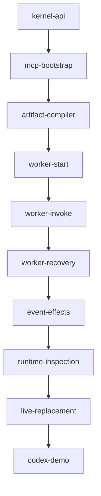

# Phase 1 — Live Genesis implementation plan

Status: implementation in progress. kernel-api is committed at `14f8d10`;
mcp-bootstrap is complete in the commit containing its checked task document.
artifact-compiler is complete in the commit containing its checked task document.
worker-start is complete in the commit containing its checked task document.
worker-invoke is complete in the commit containing its checked task document.
worker-recovery is complete in the commit containing its checked task document.
event-effects is complete in the commit containing its checked task document.
runtime-inspection is complete in the commit containing its checked task document.
live-replacement is complete in the commit containing its checked task document.
codex-demo is next. Governing architecture:
[ADR-001](../../adr/001-architecture.md), milestones 1–4 and section 9.
Unattended continuation: [amendment 04](../../prompts/phase01-implementation-amendment-04.md).
Transport/lifetime refinement: [amendment 05](../../prompts/phase01-transport-amendment-05.md).
Implementation assignment: [resume Phase 1](../../prompts/phase01-implementation.md).
Planning assignment: [complete immutable snapshot](../../prompts/phase01-planning.md).
HTTP dependency/transport correction: [amendment 03](../../prompts/phase01-dependency-amendment-03.md).
Dependency correction: [Jason/Decimal compatibility](../../prompts/phase01-dependency-amendment-02.md).
Approved amendment: [smaller worker tasks and continuous HTTP integration](../../prompts/phase01-planning-amendment-01.md).
The original planning checkpoints contained no runtime features. Read the amendments
alongside the original snapshot; they record task boundaries, verification timing,
and the evidence-based dependency correction.

## Starting and recovering work

Both planning and implementation agents must save complete new assignment instructions
under `docs/prompts/` before doing other work and identify the snapshot in their work
plan. Preserve snapshots; put approved amendments in separate files and reread them
alongside the original. For this assignment use the snapshot linked above.

Before every subtask, and after every context compaction, read that snapshot, this
plan, the current task document, and any approved amendments. A compaction summary
does not replace these reads. If documents do not exist yet, read available governing
documents and partial drafts. Also read `AGENTS.md`, `CONTRIBUTING.md`, and the ADR.
After a complete context clear or new session, inspect `git status --short` and
`git log --oneline -15`, then inspect relevant commits and their verification evidence.
Determine progress from repository state and committed work. Use the deterministic
order below when the current task is unclear; verify prerequisites before selecting
work. Uncommitted implementation is unfinished work, not a completed prerequisite.

Initial inspection found untracked `scripts/codex.sh`; preserve it and any other
unrelated changes. Do not infer authorization to modify it from this plan.

## Objective, baseline, and boundaries

A fresh Codex session connects to an independently running local BEAM, builds a
counter and aggregator through MCP, observes their interaction, replaces behavior
without changing the host PID, and reconnects while both workers remain alive.

Actual baseline at `fd8ad66`: Elixir 1.18.3 / OTP 27, Mix app `:elixir_mixir`,
`ElixirMixir.hello/0`, empty `ElixirMixir.Supervisor`, one doctest and eleven tests.
No HTTP listener, manager, generated behavior, worker registry, or domain application
exists. Development dependencies are Credo, Doctor, and Dialyxir. `mix check` and the
installed `.githooks/pre-commit` enforce format, warnings, strict Credo, 100% Doctor
coverage, ExUnit, and Dialyzer. Keep those gates and existing tests working.

Only the trusted execution kernel lives under `lib/`. Phase 1 stores definitions,
artifacts, state, request outcomes, events, and topology in memory. There is no CubDB,
manifest disk storage, restart recovery, autonomous controller, remote deployment,
UI, clustering, dependency installation by generated code, or native OTP hot upgrade.
BEAM restart loses the application. Record schema versions, logical IDs, effect IDs,
operation IDs, and commit boundaries to leave Phase 2 seams; do not implement a
persistence abstraction with an unused backend.

## Task index and deterministic order

Execute in the table's numeric order. Every prerequisite must be verified and committed.
The descriptions and dependency lists here are authoritative alongside each task's
matching prerequisite list.

| Order | Task ID and document | Outcome | Prerequisites | Milestone |
| --- | --- | --- | --- | --- |
| 1 | [kernel-api](tasks/kernel-api.md) | Bounded values, errors, request ledger, manager status | none | 1 |
| 2 | [mcp-bootstrap](tasks/mcp-bootstrap.md) | Localhost HTTP MCP status and reusable integration fixtures | kernel-api | 1 |
| 3 | [artifact-compiler](tasks/artifact-compiler.md) | Contract, immutable artifacts, define tool and HTTP tests | mcp-bootstrap | 2 |
| 4 | [worker-start](tasks/worker-start.md) | Supervised logical worker startup, inspection and stop over HTTP | artifact-compiler | 2 |
| 5 | [worker-invoke](tasks/worker-invoke.md) | Bounded event transitions, invoke tool and HTTP tests | worker-start | 2 |
| 6 | [worker-recovery](tasks/worker-recovery.md) | Crash isolation, restart budgets and HTTP continuity | worker-invoke | 2 |
| 7 | [event-effects](tasks/event-effects.md) | Emit, delayed delivery and logs tested through HTTP | worker-recovery | 3 |
| 8 | [runtime-inspection](tasks/runtime-inspection.md) | Topology, bounded history and events tool over HTTP | event-effects | 3 |
| 9 | [live-replacement](tasks/live-replacement.md) | Atomic migration, replace tool and HTTP failure/reconnect tests | runtime-inspection | 4 |
| 10 | [codex-demo](tasks/codex-demo.md) | Isolated local setup and actual Codex evidence | live-replacement | 4 |



### Continuous HTTP integration

The former worker-hosts task is replaced by worker-start, worker-invoke and
worker-recovery. The former mcp-tools and runtime-integration tasks are absorbed
into the feature tasks; no adapter or automated integration work is deferred to
an end-of-phase checkpoint. There are still ten tasks overall.

mcp-bootstrap creates the reusable real-TCP MCP client and independent BEAM fixture.
From artifact-compiler onward, every runtime feature includes its thin MCP adapter
when applicable, focused unit tests, and new real-HTTP scenarios in
`test/integration/phase01_runtime_test.exs`. Extend the same counter/aggregator journey
incrementally. Only use APIs available at the current checkpoint. Update tools/list
expectations as tools arrive; never advertise stubs for unfinished operations.

| Owning task | Newly exposed tool or behavior | Required HTTP increment |
| --- | --- | --- |
| mcp-bootstrap | runtime_inspect, shared framing/errors | Initialize/list/inspect, ingress limits, client disconnect/reconnect against independent BEAM |
| artifact-compiler | runtime_define | Valid/invalid source, missing callbacks, immutable artifact, replay/conflict and bounded errors |
| worker-start | runtime_start, runtime_stop; worker inspect | Define/start/inspect/stop, duplicate ID/init errors, state retained across client reconnect |
| worker-invoke | runtime_invoke | Increment/inspect, malformed/timeout transition, retry after disconnect commits one increment |
| worker-recovery | Existing start/stop/invoke/inspect strengthened | Real host kill, healthy peer and endpoint survive, bounded restart, stop/restart races |
| event-effects | Existing invoke gains effects | Two workers, exact aggregate result, timers/logs, replay after disconnect gives one delivery, loop/capacity limits |
| runtime-inspection | runtime_events; full inspect | Correlated history, topology, pagination/gaps, state omission and maximum wire-size bounds |
| live-replacement | runtime_replace; all seven now complete | Same PID/state, explicit migration, invalid candidate/failed migration/conflict, replacement reconnect/replay |
| codex-demo | Actual Codex evidence | Reuse passing automated suite; run the separate real Codex demonstration |

Common response/schema validation, versioning, `isError` envelopes, unknown-key
rejection, and wire-size accounting begin in mcp-bootstrap and are extended with
each tool. Each feature commit updates `docs/runtime-api.md`, the advertised tool
list, and `docs/sdlc/phase01/verification.md` with its automated evidence, keeping
actual Codex evidence pending until codex-demo. Run the growing HTTP suite in every
feature's task gate and in `mix check`. Test fixtures own cleanup on failure and
need no Docker, Codex credentials, or external service. Generated fixture code stays
under test/support, never lib/.

The worker-start checkpoint treats an unexpected host death as a retained failed
definition and permits explicit start; it does not claim automatic crash recovery.
worker-invoke adds bounded event callbacks with no effects. worker-recovery then
adds the final per-worker automatic restart budget. Each intermediate checkpoint
has complete tests for its supported behavior and remains usable over HTTP.

## Resolved implementation contracts

### Kernel ownership and execution

All runtime modules use `ElixirMixir.Runtime`; the contract is `ElixirMixir.Behavior`.
Manager is a named GenServer and the sole public mutation coordinator. MCP components
only normalize/validate arguments, call Manager, and encode bounded results. No domain
application is seeded at startup. Use one runtime per BEAM; global-registry/compiler
and integration tests run `async: false` with explicit cleanup and small test limits.

Root `:one_for_one` children, added only as needed: EventLog, artifact registry,
unique OTP Registry, callback Task.Supervisor, compiler Task.Supervisor,
DynamicSupervisor for hosts, EffectDispatcher, Manager, Hermes.Server.Registry,
MCP server supervisor, Bandit listener. Start the manager before HTTP readiness.
A host/worker-subtree failure must not restart HTTP or Manager. Failure of authoritative
Manager or artifact metadata is kernel failure: fail the application rather than
pretending to recover the graph. No Phase 1 kernel restart recovery guarantee. Manager and artifact registry are
temporary significant children with root `auto_shutdown: :any_significant`; their
loss stops authority rather than restarting empty metadata (amendment 05).
EffectDispatcher uses the same fatal-authority boundary once present: restarting an
empty dispatcher would discard reservations and invalidate accepted batch ownership.

Manager serializes mutations and assigns operation context. Bounded callback/compiler
work runs in unlinked, monitored tasks; neither Manager nor MCP executes generated
callbacks directly. Host owns committed `{artifact, data, worker_revision,
state_revision}` and processes operations sequentially. During a callback Host waits
only for its own task result/DOWN with a finite deadline; set `max_heap_size` with kill enabled and bounded diagnostic logging,
kill and join overdue tasks,
discard late results, retain last state. This preserves normal host identity and avoids
an infinite callback freezing the control plane. Manager may block for at most the
operation deadline; dispatcher submits subsequent deliveries asynchronously so it
cannot deadlock Manager or recurse into a host transition.

Use `DynamicSupervisor` children with `restart: :temporary`; Manager monitors hosts
and explicitly schedules bounded restart attempts through the supervisor. This keeps
per-worker crash budgets from taking down all workers. Allow three restart attempts
per worker per rolling 10 seconds; the next failure sets `failed`, keeps the definition,
and requires explicit `runtime_start`. Count init failures toward that budget. Crash
restarts rerun `init(config)` with the active artifact: Phase 1 does not preserve worker
state across crashes. Keep monotonically increasing worker/state revision counters in
Manager; bump them on reinitialization. Explicit stop cancels restarts and timers,
retains the definition as stopped, and never counts as a crash. Starting a stopped or
failed ID explicitly resets its restart budget and reinitializes it. Starting a running
ID returns `WORKER_EXISTS`; changing a retained definition's artifact/config requires
stop then start. Diagnostic PIDs are strings; routing always uses logical ID.

### Values, limits, and operation outcomes

All external maps have string keys. JSON values are null, booleans, finite numbers,
UTF-8 strings, lists, or maps with string keys; reject structs, atoms except
`nil/true/false`, PIDs, refs, ports, functions, and non-finite floats. Config, event,
and state roots are maps. Validate bounded depth (16) and encoded bytes with Jason;
reject rather than silently truncate mutable input/state/reply/effects. The depth
limit applies to application values; Manager allows one argument-envelope level and
HTTP/response validation allows four protocol-envelope levels in addition. Inspect and
history pages may omit large fields with explicit `truncated` metadata. Internal
constant atoms are allowed; never atomize client IDs or map keys.

Defaults (configurable downward in tests; reject non-positive or excessive settings):

| Resource | Limit |
| --- | --- |
| Source per define | 32 KiB UTF-8 |
| Compilation attempts / loaded artifact slots per BEAM lifetime | 128, including failed attempts |
| Modules per submitted source | exactly one top-level template module |
| Compile deadline | 5,000 ms |
| Compiler task heap / callback task heap | 64 MiB / 8 MiB, measured in VM words |
| Callback init/event/migration deadline | 200 ms each |
| Worker definitions including stopped/failed | 32 |
| Config, event, state, reply | 16 KiB each |
| Effects per transition | 16 |
| Pending deliveries plus timers | 256 total |
| Maximum timer delay | 60,000 ms |
| Effect hop budget | 16 per originating invoke |
| Event history | 1,000 records, 2 KiB metadata per record |
| Events/inspect page | default 25, max 100 records |
| Request ledger | 1,024 entries, 10-minute retention |
| Diagnostic text | 2 KiB per diagnostic; max 10 per operation |
| Whole MCP tool result including JSON-RPC/content encoding | 64 KiB |
| Incoming HTTP body | 64 KiB |
| Operation API wait | 7,000 ms (compile + bookkeeping margin) |

Reserve a compile slot before parsing and never reuse it during the BEAM lifetime.
Use a fixed pool of 128 preallocated module atoms `ElixirMixir.Generated.Slot001` …
`Slot128`; do not incorporate caller text into module atoms. Record consumed failures.
Use monitored helper `spawn_opt` (or Task plus an initial process flag) to set heap
budgets before user work begins; include compiler helper processes in diagnostics.
Source parsing and compilation can still allocate other atoms or execute macros;
these controls bound accepted work, not arbitrary hostile BEAM code. Tasks are not
security isolation. Run generated code only in the disposable environment below.

Public Manager functions: `define(args)`, `start_worker(args)`, `replace(args)`,
`invoke(args)`, `inspect_runtime(args)`, `stop_worker(args)`, `events(args)` return
`{:ok, result_map}` or `{:error, error_map}`. All results carry `api_version: "1"`,
`generation`, and mutation `request_id`; maps on the wire use string keys. Errors
carry `code`, bounded `message`, and bounded `details`, never raw stack traces.
Codes: `INVALID_ARGUMENT`, `LIMIT_EXCEEDED`, `COMPILE_FAILED`, `CALLBACK_MISSING`,
`ARTIFACT_NOT_FOUND`, `WORKER_NOT_FOUND`, `WORKER_EXISTS`, `WORKER_NOT_RUNNING`,
`CALLBACK_FAILED`, `CALLBACK_TIMEOUT`, `INVALID_TRANSITION`, `MIGRATION_FAILED`,
`REVISION_CONFLICT`, `REQUEST_ID_CONFLICT`, `BUSY`, and `INTERNAL_ERROR`.

Require nonempty ASCII IDs matching `[a-zA-Z0-9_-]{1,64}` for request/worker/logical
names. Artifact IDs are opaque strings returned by define. Mutations require
`request_id`; canonicalize validated arguments with sorted keys, excluding request ID,
and hash operation plus arguments. Same ID/same hash replays the exact recorded result
without rerunning callbacks/effects, including failures. Different hash returns
`REQUEST_ID_CONFLICT`. Ledger survives HTTP sessions, not VM restart. Never evict an
in-flight operation; if full, evict expired completed entries only, otherwise `BUSY`.
Report retention in inspect; after expiration retries can run again. Validation errors
before a valid request ID are not cached. In-flight identical retries wait for or
replay the one result; do not start a second mutation. HTTP disconnect does not cancel
accepted work. Transport JSON-RPC IDs and mutation request IDs have different roles.

Global generation increases once per committed define/start/stop/invoke/replace or
lifecycle change; failed validation/migration/conflict does not advance it. Artifacts
have immutable integer revision per logical name, worker_revision starts at 1 and
increments on replacement/lifecycle mutation, state_revision starts at 1 and increments
on accepted state transitions/reinitialization/migration. Read APIs do not mutate them.
Rejected events retain data and revisions. Request replay returns the original generation.

### Generated contract and compiler

Input `expected_behavior` must be `"elixir_mixir.behavior.v1"`. Source is one
`defmodule Generated do ... end` template. Parse with `Code.string_to_quoted/2`,
reject other top-level forms, nested module declarations, and obvious dynamic module
construction (`defmodule`, `Module.create`, `Code.compile_*`) in its body, rewrite
only the outer alias to the reserved slot, then `Code.compile_quoted/2` using a
synthetic filename. This is namespace hygiene, not a sandbox or a complete static
analyzer. Reject compilation output unless it contains exactly the reserved module.
Keep any failed slot consumed; never load over a prior artifact or purge active code.
Treat warnings as define failure with bounded diagnostics; use `Code.with_diagnostics/2`
inside the compiler task, without changing global compiler options.

Required callbacks, documented and typed in `ElixirMixir.Behavior`:

```elixir
@callback init(map()) :: {:ok, map()} | {:error, term()}
@callback handle_event(map(), map()) ::
  {:ok, term(), map(), [map()]} | {:error, term()}
@callback state_schema() :: pos_integer()
@callback migrate(map(), map()) :: {:ok, map()} | {:error, term()}
```

Require all four even for same-schema replacements; same-schema replacement bypasses
migration and retains data exactly. Different-schema replacement calls candidate
`migrate/2` with `worker_id`, old/new artifact IDs, old/new schema versions,
worker/state revisions and request ID in string-key metadata. Migration cannot emit
effects. Validate candidate schema callback under the same deadline at define time.
Store original source, SHA-256, compiled module/BEAM, artifact ID, logical name,
revision, contract/schema versions, and bounded diagnostics in the in-memory immutable
registry. Compilation never activates a worker. No generated source enters `lib/`.

### Host transitions, effects, and replacement

Start resolves artifact, validates config/capacity, executes bounded init, validates
state, then publishes a running definition. Failed init leaves no running child or
half-created definition. Invocation stages the complete callback result; all reply,
state, and effect checks and dispatcher capacity reservation must pass before committing
host state. A reservation token commits once or releases on failure/DOWN/deadline.
Return effect IDs with `accepted` status, not a claim of downstream delivery.
Dispatcher receives committed batches after the host confirms the transition to Manager.
No generated effect runs on failed transition or failed migration. A crash in the tiny
host-commit/dispatch gap can lose effects in Phase 1; no transactional crash guarantee.

Effects are string-key maps:

- `{"type":"emit","to":worker_id,"event":map}` queues one event.
- `{"type":"schedule","to":worker_id,"delay_ms":integer,"event":map}`
  schedules through `Process.send_after/3` and resolves destination when due.
- `{"type":"log","level":"debug|info|warning|error","message":string,"metadata":map}`
  records a bounded structured Logger event and history entry; do not turn level text
  into arbitrary atoms.

All effects inherit originating request ID, deterministic effect ID, source worker ID,
and remaining hop count. Derive internal delivery IDs as 64-character SHA-256 hex
strings over the originating request ID and bounded effect path; consume one hop per delivery and record dropped loops as
`effect_failed`. Unknown targets, stopped targets, exhausted hops, or delivery errors
record failure; they do not roll back an already accepted source transition or retry
indefinitely. Best-effort once-per-dispatch, no exactly-once claim. Delays remain in
memory only. Explicit stop cancels timers originating from that worker and drops
queued deliveries to stopped workers. Crash restart keeps logical routing; document
whether a due event was delivered or failed in history. Bound dispatcher admission and
release reservations for tasks/hosts that die before commit.

Replacement resolves worker/candidate, compares `expected_revision` to worker_revision
inside the host's serialized transition, stages same-schema retention or explicit
migration, validates new state, then atomically changes artifact/data/revisions in the
same host. Confirm active artifact and unchanged PID before Manager acknowledges.
Expected-revision conflicts, migration errors, exceptions, invalid outputs, or deadlines
leave old state/artifact/PID/revisions intact. Host death returns `CALLBACK_FAILED`
and lifecycle diagnostics, never successful replacement. No automatic reverse migration:
rollback is another explicit replace with a compatible artifact and migration.

### Inspection and events

EventLog is a bounded ring with monotonic sequence, UTC timestamp, type, logical ID,
artifact revision, request/correlation ID, outcome, and bounded metadata. Record
compile success/failure, worker created/started/stopped/crashed/restarted/restart-exhausted,
event accepted/delivered/failed, replacement/migration failure, and effect scheduled/failed.
No recovery events until Phase 2. Include drops/truncation counts. `events` accepts
`after` (exclusive sequence, default 0), `limit`, optional worker ID; returns records,
next cursor, oldest available sequence, and a gap flag for evicted history.

`inspect_runtime` accepts optional worker ID, `detail` (`summary` default or `state`),
`limit`, and opaque pagination cursor. Summary gives generation, limits/ledger retention,
health, sorted worker pages, stopped/failed definitions, active artifacts, diagnostic
PID, revisions, restart counts, pending effects/timers, and bounded graph edges.
Worker detail includes bounded state or explicit omission metadata, never executes a
generated callback. Use kernel host snapshot messages with finite timeout; report
unavailable/stale data honestly. Keep counters/relationships bounded by existing
worker IDs, aggregate edge counts rather than append each event. Unknown worker gives
`WORKER_NOT_FOUND`; malformed cursors give `INVALID_ARGUMENT`. Final encoded response
must fit 64 KiB; shrink page/omit state with metadata, or return bounded
`LIMIT_EXCEEDED` without applying a new mutation. Preflight mutation results before
commit so an oversized reply never becomes a reported success that cannot be encoded.

### MCP surface

Seven tool names exactly as ADR section 7; no eighth status tool. Initially expose
only `runtime_inspect` in mcp-bootstrap. Add each other tool in its owning feature
task as listed in Continuous HTTP integration; all seven exist after live-replacement. Use explicit component names and schemas,
reject unknown argument keys; do not rely solely on permissive Peri coercion.

| Tool | Required inputs | Optional inputs | Successful result fields beyond common envelope |
| --- | --- | --- | --- |
| runtime_define | logical_name, source, expected_behavior, request_id | none | artifact_id, module, source_hash, revision, state_schema, compilation_status, diagnostics, callbacks_valid |
| runtime_start | worker_id, artifact_id, config, request_id | none | worker_id, pid, implementation_version, worker_revision, state_revision, status |
| runtime_replace | worker_id, artifact_id, expected_revision, request_id | none | previous_revision, new_revision, worker_revision, state_revision, migration_result, pid_before, pid_after |
| runtime_invoke | worker_id, event, request_id | none | reply, worker_revision, state_revision, effects |
| runtime_inspect | none | worker_id, detail, limit, cursor | runtime or worker snapshot described above |
| runtime_stop | worker_id, request_id | none | worker_id, status: stopped, definition_retained: true, worker_revision |
| runtime_events | none | after, limit, worker_id | events, next_cursor, oldest_sequence, gap |

MCP server version `0.1.0`, application API version `"1"`, MCP protocol negotiated by
Hermes (baseline `2025-03-26`). Transport/protocol failures use JSON-RPC errors;
valid tool calls with runtime failures return MCP tool result `isError: true` with
the stable bounded error envelope. Include the same JSON envelope in text content
for clients using older protocol versions; structuredContent when supported. Account
for duplicated text/structured encoding in the 64 KiB limit.

## Dependency and transport decisions

Verified 2026-11-10 using official release metadata and published package source.
Use exact direct pins for the first implementation: `hermes_mcp == 0.14.1`,
`plug == 1.20.3`, `bandit == 1.14.1`, `jason == 1.4.5`; add `:crypto` for SHA-256.
Their Elixir requirements are respectively `~> 1.18`, `~> 1.15`, `~> 1.13`,
`~> 1.4`, compatible with 1.18.3. Hermes requires Plug `~> 1.18` (optional,
therefore explicitly enable it), Finch `~> 0.19`, Peri `~> 0.4`, Telemetry `~> 1.2`;
Bandit also requires Plug `~> 1.18` and allows Telemetry 1.x. Jason's Decimal
integration is optional and compatible with existing Decimal. Resolve transitive
versions and commit `mix.lock` in the owning task: Jason/:crypto in kernel-api
before its JSON/hash helpers, and Hermes/Plug/Bandit in mcp-bootstrap; dependency compilation and full
`mix check` on OTP 27 prove executable compatibility. No claim that resolution has
already run in this documentation checkpoint. Do not add Phoenix or a new HTTP test
client: OTP `:httpc`/`:inets` in test support suffice. Do not change pins silently;
record an evidence-based amendment if a dependency cannot meet the task contract.

Official sources (source code takes precedence over inconsistent prose examples):

- [Hermes release metadata](https://hex.pm/api/packages/hermes_mcp/releases/0.14.1)
  and [published source archive](https://repo.hex.pm/tarballs/hermes_mcp-0.14.1.tar):
  inspected `mix.exs`, Server, Server.Supervisor, Component.Tool, Response,
  Application, and StreamableHTTP.Plug. The GitHub repository link returned 404;
  the official Hex archive remains available.
- [Hermes versioned README](https://hexdocs.pm/hermes_mcp/0.14.1/readme.html)
  documents Plug forwarding; generic Server/transport quick-start examples contain
  obsolete call arities and legacy `/sse` paths. Use actual child specs below.
- [Bandit release](https://hex.pm/api/packages/bandit/releases/1.14.1),
  [Plug release](https://hex.pm/api/packages/plug/releases/1.20.3),
  [Jason release](https://hex.pm/api/packages/jason/releases/1.4.5),
  [Bandit API](https://hexdocs.pm/bandit/1.8.0/Bandit.html).
- [MCP Streamable HTTP specification](https://modelcontextprotocol.io/specification/2025-03-26/basic/transports):
  single endpoint, POST JSON or SSE responses, GET SSE or 405, session handling,
  Origin checks, localhost binding, disconnect semantics.
- [Official Codex connection example](https://developers.openai.com/learn/docs-mcp)
  verifies `codex mcp add NAME --url URL` and `codex mcp list`.
- [Elixir 1.18 Code](https://hexdocs.pm/elixir/1.18/Code.html),
  [GenServer](https://hexdocs.pm/elixir/1.18/GenServer.html),
  [DynamicSupervisor](https://hexdocs.pm/elixir/1.18/DynamicSupervisor.html),
  [Registry](https://hexdocs.pm/elixir/1.18/Registry.html), and
  [OTP code loading](https://www.erlang.org/doc/system/code_loading.html)
  are the implementation API references; use installed 1.18.3 docs/specs for exact signatures. The versioned Code docs
  confirm `string_to_quoted/2`, `compile_quoted/2`, and `with_diagnostics/2`; the
  published Bandit 1.8.0 source confirms top-level `ip` and `port` options.

Use `use Hermes.Server, name: "elixir-mixir", version: "0.1.0", capabilities: [:tools]`.
Start `Hermes.Server.Registry`, then `{ElixirMixir.MCP.Server, transport: :streamable_http}`
(the generated child spec calls `Hermes.Server.Supervisor.start_link/2`), then
`{Bandit, plug: ElixirMixir.MCP.Router, ip: {127,0,0,1}, port: 4100}`.
Router forwards `/mcp` to `Hermes.Server.Transport.StreamableHTTP.Plug` with
`init_opts: [server: ElixirMixir.MCP.Server]`. Initialize that plug at request time
after the Hermes registry is running. Components use `use Hermes.Server.Component,
type: :tool`, `schema do ... end`, and `execute(params, frame)` returning
`{:reply, response, frame}`. Use `Hermes.Server.Response.tool/0`, `json/2` or
`structured/2`, and `error/2`; do not use stale README `handle_tool` examples.

Add a small outer Plug for bounded body reading (cache parsed body for Hermes),
allowed Host and Origin checking (missing Origin allowed for CLI; only loopback origin
with configured port allowed), and readiness `GET /health`.
Hermes' Plug source advertises Origin validation but does not implement it: kernel
wrapper must do so. Reject non-loopback bind configuration in normal local mode.
Do not preparse an unlimited body. Normalize accepted notification responses to empty
202 if needed; package source currently returns `{}`. Test actual wire behavior rather
than assuming prose conformance. Disable Hermes verbose payload logging so submitted
source/state cannot flood logs. No bearer auth in isolated localhost Phase 1.

## Local isolation and operation

codex-demo will supply a Dockerfile and exact tested commands. Use a disposable,
unprivileged Elixir 1.18.3/OTP 27 container with pre-fetched dependencies, no host
credentials/source mounts/Docker socket, read-only root filesystem, writable tmpfs,
`--cap-drop ALL --security-opt no-new-privileges --memory 512m --cpus 1 --pids-limit 128`.
Build an OTP release into the image and run `bin/elixir_mixir start`, with
distribution disabled and release temporary files under `/tmp`. This avoids Mix
compilation or writes to the read-only application tree during startup.
Run it with `--network host` on Linux so the container's loopback-only listener is
reachable from host Codex at `127.0.0.1:4100`; do not use port publishing with a
loopback-only container listener. Document that host networking permits network
access and is not a network sandbox; use a disposable Linux VM for stronger isolation
or non-Linux hosts. No secrets or valuable infrastructure in that VM. Host Codex
credentials stay outside the runtime container. This is not a secure Elixir sandbox.

Independent terminal: `mix run --no-halt` (inside the prepared environment), wait for
`GET /health`, then on client host `codex mcp add elixir-mixir --url
http://127.0.0.1:4100/mcp`, `codex mcp list`, and `codex`. These commands must be
rendered as executable single lines in the final README. Stop/restart Codex without
stopping the runtime. Runtime startup is not a Codex stdio subprocess.

## ADR 9.4 acceptance traceability

Each row maps one original checkbox. Automated checks validate substrate behavior;
only the actual demonstration establishes the claims specifically about Codex.

| # | Acceptance criterion | Implementation tasks | Verification evidence |
| --- | --- | --- | --- |
| A01 | Codex connects to running runtime through MCP | mcp-bootstrap, codex-demo | Early HTTP initialize/tools/list/inspect test; actual Codex transcript |
| A02 | Codex creates valid module using MCP | artifact-compiler, codex-demo | Define HTTP test in compiler checkpoint; Codex define transcript |
| A03 | Runtime compiles and loads module | artifact-compiler | Exports/hash/registry assertions plus real HTTP define |
| A04 | Supervised worker starts with logical ID | worker-start | Supervisor membership, Registry lookup and define/start/inspect HTTP journey |
| A05 | Codex invokes and inspects state | worker-invoke, runtime-inspection, codex-demo | Early increment/inspect HTTP assertions; full snapshot checks and Codex observations |
| A06 | Codex creates second worker and connects both | event-effects, runtime-inspection, codex-demo | HTTP counter/aggregator arithmetic, then topology checks in inspection checkpoint; Codex transcript |
| A07 | Running implementation replaced | live-replacement, codex-demo | Same-task HTTP replacement confirms active artifact and changed reply |
| A08 | Target retains PID on normal replacement | live-replacement, codex-demo | HTTP before/after PID equality plus kernel monitor with no DOWN |
| A09 | State preserved or explicitly migrated | live-replacement, codex-demo | Same-task HTTP same-schema equality and different-schema migration |
| A10 | Failed compilation does not alter active implementation | artifact-compiler, worker-invoke, live-replacement | Compiler HTTP rejection/immutable registry; invocation checkpoint checks invalid define leaves live worker unchanged |
| A11 | Failed migration does not corrupt worker | live-replacement | Same-task HTTP error/invalid/exception/timeout migration retains PID/artifact/state/revisions |
| A12 | Crashing worker does not terminate MCP | worker-start, worker-recovery | Early host death leaves HTTP alive; recovery checkpoint proves peer isolation and restart bound |
| A13 | Codex disconnect/reconnect while runtime alive | mcp-bootstrap, worker-start, worker-invoke, event-effects, live-replacement, codex-demo | Successively verify BEAM, worker state, one increment/effect/replacement across HTTP sessions; actual fresh Codex session |
| A14 | Entire demonstration local | mcp-bootstrap, codex-demo | Loopback socket/config tests; isolated local startup and actual demo evidence |

Additional required checks are owned when their behavior arrives: missing callbacks
and invalid source (artifact-compiler), state/config/worker bounds (worker-start),
event/reply limits and timeouts (worker-invoke), actual host kill and restart exhaustion
(worker-recovery), timer/effect/loop capacity and one-delivery replay (event-effects),
bounded history/topology/response pagination (runtime-inspection), and revision races,
queued event ordering and replacement reconnect (live-replacement). Request IDs,
response limits, protocol framing and schema validation are exercised with every new
tool, starting in mcp-bootstrap. Unit and HTTP tests inspect actual state/lifecycle
as well as response codes and pass with only committed prerequisites.

## Mandatory completion gate

Retain [rules/50-subtask-workflow.md](../../../rules/50-subtask-workflow.md); do not
create a duplicate rule. Every task, including the last and documentation-only tasks,
must follow this sequence:

1. Complete code changes and focused unit tests, including relevant failure paths.
   For documentation-only tasks verify documents; do not invent unrelated code tests.
2. Pass focused tests and all task-specific verification, including the growing
   real-HTTP integration suite from mcp-bootstrap onward. Every new capability
   includes its HTTP scenarios in the same commit; no deferred integration task.
3. Pass the complete `mix check` gate and resolve every finding.
4. Commit only the verified task, tests, and relevant documentation using a Conventional
   Commit header, blank line, and nonempty explanatory body, with installed pre-commit
   hook enabled. Check `git config --get core.hooksPath` is `.githooks`; install via
   `./scripts/install-git-hooks.sh` if absent. Do not bypass hooks.
5. Only then begin another task. A prerequisite is complete only after verification
   and commit. Record completion commit/evidence in the task checklist in that commit;
   the commit containing the checked checklist is the checkpoint (no self-hash needed).

Unexpected results require root-cause investigation, a proving test, and a fix to the
system under test. After three unsuccessful attempts to fix a problem, stop and ask
the user for direction. Do not lower quality thresholds or suppress warnings.

## Completion and delivery

Phase 1 is complete only when all ten task checkpoints exist, full `mix check` passes,
all A01–A14 evidence is present, all seven tools have passing incremental real-HTTP coverage, and the actual
Codex demonstration/reconnect transcript is committed. Passing an ExUnit HTTP scenario
alone is insufficient. Record limitations and any approved amendments explicitly.

For this planning-only checkpoint, verify task/graph/link/dependency/order agreement,
acyclicity, complete A01–A14 mapping, resolved contracts, snapshot preservation, and
regenerated recovery rules; run `mix check`, then commit snapshot, plan/tasks, recovery
rule, and generated `AGENTS.md` together. Leave runtime source and `scripts/codex.sh`
untouched and stop. Runtime features are a subsequent assignment.
