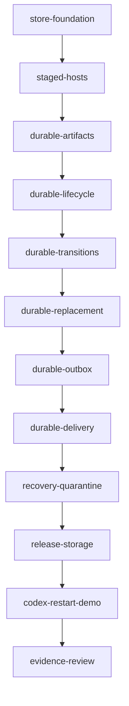

# Phase 2 restart feature plan — Durable Genesis

Status: store-foundation through durable-delivery verified; remaining implementation tasks are pending.
Governing assignment: [immutable snapshot](../../prompts/phase02-restart-planning.md).
Implementation assignment: [snapshot](../../prompts/phase02-restart-implementation.md).
Architecture: [ADR-001](../../adr/001-architecture-initial-phases.md), section 10 and
milestones 5–7. [Planning verification](planning-verification.md) records planning
checks; [implementation verification](verification.md) must record future evidence.

## Starting, resuming, and tracking work

Both planning and implementation agents must save complete new assignments under
`docs/prompts/` before other work. Before every subtask and after every compaction,
reread the assignment snapshot, this plan, the current task document, `AGENTS.md`,
and separately recorded approved amendments. A compaction summary does not replace
these reads. If documents are absent, read available governing documents and drafts.
Preserve originals and record approved amendments separately. For a new session or
complete context clear, inspect `git status --short`, `git log --oneline -15`,
relevant commits, and verification evidence. Select the first unfinished task in
the order below only after verifying that its prerequisites are committed.

This assignment is one documentation-and-rules checkpoint, not twelve implementation
checkpoints. The implementation assignment must also be preserved and linked here
when it is received. Check off task completion only after its tests and full gate
pass and its commit exists. The commit containing a checked task identifies that
checkpoint; record its hash in a subsequent checkpoint or final report rather than
attempting a self-referential hash. Keep evidence and plan status synchronized.

At planning start, historical prompts were deleted from their former locations and
present under untracked `docs/prompts/archived/`; an empty
`docs/prompts/phase-2-plan-creation.md` and `scripts/codex.sh` were also untracked.
Preserve these user changes. Older Phase 1 links are historical and some are stale;
locate archived snapshots for reading without staging or repairing that relocation.

## Objective, baseline, and boundaries

A previously agent-created application recovers after abrupt termination of the
entire BEAM using the same store, without an LLM. It retains source, logical graph,
selected artifact versions, and committed state; recreates hosts; resumes durable
work; and accepts further MCP operations after recovery.

Baseline: `81830cb`, Elixir 1.18.3 / OTP 27, all seven Phase 1 MCP tools implemented.
Phase 1 implementation commits run from `14f8d10` through `baabfe9`; the actual
Codex demonstration is committed in `8631dbd`, with verification reconciled in
`edaff7d`. The [Phase 1 plan](../phase01/plan.md), checked task documents, and
[evidence index](../phase01/evidence/codex-sessions.json) show two actual sessions
and 59 MCP calls. Phase 1 is complete; its original bootstrap baseline is obsolete.

Manager owns volatile definitions, generation and request ledger. ProcessHost
publishes callback state/replacement before Manager completes the request. The
dispatcher reserves and delivers effects in memory, with separate completion.
ArtifactRegistry has 128 fixed module atoms and a BEAM-lifetime slot counter;
metadata disappears on restart. Host crash recovery reruns init and loses state.
Health currently checks process presence rather than recovery completion. Existing
test fixtures launch independent BEAMs with HTTP and test-only stdin controls.
The production release is read-only and its demonstration currently discards data.
These are concrete seams to change; no durable backend exists yet.

Keep a small single-node OTP kernel. Use CubDB, not an event-sourcing framework.
Exclude clustering, autonomous control, generated database migrations, a secure
Elixir sandbox, and ADR-002's additional developer-experience capabilities.
Generated callbacks remain trusted code with VM privileges: kernel transactions
cannot undo direct callback IO or compile-time side effects. Exactly-once external
effects and machine power-loss certification are outside this proof.

## Task index and deterministic execution order

Execute in numeric order; dependencies below are also the full graph edge set.
Store-foundation (`b9dea1a`), staged-hosts (`fa5b364`), durable-artifacts (`12e4c30`), durable-lifecycle (`6d60201`), durable-transitions (`a0114e0`), durable-replacement (`461350f`), durable-outbox (`1f43b8c`) and durable-delivery are verified in their checkpoint commits. Remaining tasks are pending. Sizes are relative, not hours.

| Order | Task ID and document | Outcome | Prerequisites | Size | Milestone |
| --- | --- | --- | --- | --- | --- |
| 1 | [store-foundation](tasks/store-foundation.md) | Configured store, bounded records and restart fixture | none | 3 | 5 |
| 2 | [staged-hosts](tasks/staged-hosts.md) | Prepare/publish protocol with unchanged memory behavior | store-foundation | 5 | 5 |
| 3 | [durable-artifacts](tasks/durable-artifacts.md) | Durable definitions, outcomes and recompilation | staged-hosts | 5 | 5 |
| 4 | [durable-lifecycle](tasks/durable-lifecycle.md) | Committed desired graph and initial state recovery | durable-artifacts | 8 | 5 |
| 5 | [durable-transitions](tasks/durable-transitions.md) | Durable event state and host crash restoration | durable-lifecycle | 8 | 6 |
| 6 | [durable-replacement](tasks/durable-replacement.md) | Atomic artifact selection and migrated state | durable-transitions | 5 | 6 |
| 7 | [durable-outbox](tasks/durable-outbox.md) | State and pending effects committed together | durable-replacement | 8 | 7 |
| 8 | [durable-delivery](tasks/durable-delivery.md) | Timer restoration and atomic internal delivery | durable-outbox | 8 | 7 |
| 9 | [recovery-quarantine](tasks/recovery-quarantine.md) | Fault isolation and bounded recovery inspection | durable-delivery | 5 | 7 |
| 10 | [release-storage](tasks/release-storage.md) | Retained release volume and restart instructions | recovery-quarantine | 3 | 7 |
| 11 | [codex-restart-demo](tasks/codex-restart-demo.md) | Actual Codex creation, crash, recovery and evolution | release-storage | 5 | 7 |
| 12 | [evidence-review](tasks/evidence-review.md) | Acceptance and evidence reconciled | codex-restart-demo | 1 | 7 |

### Continuous integration and checkpoint boundaries

Every runtime task extends the real-HTTP independent-BEAM suite and runs all existing
MCP/integration tests. Introduce retained-directory and actual SIGKILL fixture support
in store-foundation; first HTTP define/kill/recover coverage belongs to
durable-artifacts, not the demonstration. Add lifecycle, state, replacement and
effect interruption tests in their owning tasks. Use test-only barriers around
prepare, durable commit and live publication, never production fault-injection tools.

Memory mode keeps Phase 1 functionality. Durable mode is explicitly selected by a
data directory and progressively enables operations: no mutations at store-foundation
or staged-hosts; define at durable-artifacts; start/stop at durable-lifecycle;
effect-free invoke at durable-transitions; replace at durable-replacement. Until
supported, a mutation returns `DURABILITY_UNAVAILABLE` before callback execution or
any change. Nonempty effects are rejected before commit until durable-outbox.
That task accepts durable pending work with dispatch paused; durable-delivery enables
dispatch. Document these temporary boundaries and test them in each checkpoint.
Do not present an unfinished checkpoint as the completed Phase 2 guarantee.

The final demo and evidence review integrate no missing runtime subsystems and
introduce no deferred automated restart tests.

## Resolved implementation contracts

### Storage, configuration and format

Add production dependency `{:cubdb, "== 2.0.2"}` and lock it in the first task.
Keep all CubDB calls inside `ElixirMixir.Runtime.Store`; expose
`start_link/1`, `snapshot/1`, and `commit/3` (store, expected generation, prepared
change). A prepared change contains validated puts/deletes, the resulting bounded
outcome, operation identity, and generation decision. Return `{:ok, outcome}` or a
typed kernel error. Generated code never runs inside a database transaction.
Use `CubDB.transaction/2` and `CubDB.Tx` get/put/delete; return
`{:commit, tx, result}` or `{:cancel, reason}`. Keep `auto_file_sync: true` and
automatic compaction enabled; do not expose a durability-disabling switch.

Configure `:storage` as `mode: :memory` by default to preserve existing disposable
experiments. `ELIXIR_MIXIR_DATA_DIR` selects `mode: :durable` with an absolute,
expanded directory; programmatic durable configuration requires `data_dir`.
Explicit invalid/unwritable storage fails startup; never fall back to memory.
The final documented restart workflow always sets this variable. Unit tests default
to memory and durable tests own temporary directories. One VM exclusively owns a
data directory; simultaneous VMs sharing it are unsupported. Reject duplicate
store ownership within a VM. Document this operator constraint rather than adding
a stale lock-file protocol that would break abrupt recovery.

Use one CubDB database with versioned kernel records. Fixed tuple key tags may be
atoms known at compile time; user identifiers stay binaries. Values are bounded
maps of scalar/JSON data. Never deserialize user text into atoms. Record layout:

| Record key | Persisted contents |
| --- | --- |
| `:meta` | format version 1, runtime lineage ID, generation, next audit sequence |
| `{:artifact, id}` | original source/hash, logical name/revision, contract/schema, original module identity, bounded compilation metadata |
| `{:worker, id}` | artifact ID, desired status, observed failure/quarantine, config, worker revision, restart budget timestamps |
| `{:state, id}` | schema, data, state revision, last operation ID and checkpoint time |
| `{:request, request_id}` | argument hash, unique operation ID, admission/completion timestamps, pending or exact bounded outcome |
| `{:effect, effect_id}` | origin operation/correlation, path/hops, source/target, payload, deadline and pending status |
| `{:edge, source, target}` | successful delivery count for bounded observed topology |
| `{:audit, sequence}` | bounded operation/lifecycle outcome and IDs, no copied source/state |

An empty store initializes version 1. Unknown format versions or unreadable global
metadata fail startup without rewriting or clearing data. No migration from Phase 1
memory is promised. New additive optional fields may use documented defaults;
incompatible future format changes require a separate migration assignment.
The store validator enforces existing source/state/effect/response/worker limits
and cross-record references for changed records and their active dependencies before
commits. Preserved quarantined records do not block unrelated valid writes or a stop
used to repair a broken definition. Recovery handles isolated invalid records as
specified below rather than treating every record failure as global corruption.

Bound durable artifacts to the configured artifact-slot ceiling (128 maximum),
worker definitions to 32, pending effects to 256, completed request retention to
the existing 1,024 entries / 10 minutes, audit records to the event-history limit
(1,000), and observed edges to worker pairs. Use existing downward limit overrides.
Reject new work with `LIMIT_EXCEEDED` or `BUSY` rather than evicting retained outcomes
or pending effects. Compaction reclaims overwritten/deleted records. Disk exhaustion
is a store failure, not a reason to drop committed data.

### Prepare, commit, publish, acknowledge

Manager remains the sole writer/coordinator. Add internal ProcessHost
`prepare_invoke`, `prepare_replace`, `publish`, and `abort` calls. Preparing retains
the old public state and holds one staged candidate tagged with operation ID, base
revisions and incarnation. It invokes bounded callbacks once, validates all values,
reserves batch capacity, and preflights the full MCP outcome. Publication installs
only the matching staged candidate; repeated publication of its operation is safe.
Other managers, stale tokens, revisions and old incarnations cannot publish it.

For durable mutations: reserve and persist the request admission; prepare outside
CubDB; atomically commit all affected records, final outcome, generation and audit;
publish live metadata/host state; wake dispatch; then acknowledge. Failed callbacks
commit an error outcome without changing state or generation. Preparation failures
release reservations and leave prior live/durable state intact. Memory mode uses
the same prepare/publish sequence with its existing in-memory authority.

If the store write raises, times out or its result is uncertain, stop accepting
mutations and shut down the significant runtime subtree; do not report a definitive
rollback or continue from memory. Store death is significant too. The next process
start reads the actual committed outcome. If live publication fails after a known
commit, use the same shutdown/recovery path: never overwrite the durable success
with failure, and never acknowledge a live state inconsistent with its commit.
Client disconnect leaves an admitted operation running. Existing API waits remain
bounded; an uncertain response is retried with the identical request ID.

| Operation | Atomic records and publication behavior |
| --- | --- |
| define | Store source/metadata and outcome before registry publication or activation eligibility |
| start | Bounded init in an unroutable candidate host, then worker + initial state + outcome; expose routing after commit |
| stop | Commit stopped desired status, source-effect cancellations and outcome; then terminate/unregister host; repeat stop is a no-op |
| invoke | Commit state/revision, complete effect batch, outcome and audit together; then publish |
| replace | Commit selected artifact, migrated/preserved state, revisions and outcome together; publish inside the existing host |
| internal delivery | Commit target transition, child effects and deletion of parent pending effect together; then publish and dispatch |

Every changed kernel operation advances durable generation once; failures, reads,
replays and no-op stops do not. Delivery success advances it once, including an
internal transition. Timer wakeup/claim alone does not. Terminal delivery failure,
cancellation, or log completion advances it once for its durable queue mutation.
Host crash/retry status changes are committed lifecycle changes. Boot reconstruction
alone does not bump committed worker/state revisions or generation.

### Identity, request recovery and compilation

Use persisted random 128-bit operation IDs, generated once at admission; request IDs
remain caller keys. Effect IDs hash the operation ID and bounded effect path,
retaining request_id as correlation only. This avoids collisions when a caller
reuses an expired request ID. Hashing and argument comparison retain existing API
semantics; conflicting retained IDs return `REQUEST_ID_CONFLICT`.

Persist request deadlines using UTC epoch milliseconds, not monotonic VM values.
At boot convert pending external requests to retained `OPERATION_INTERRUPTED` errors
with unchanged state; a new request ID may retry them. A transactionally completed
request replays its exact historical outcome, even if its response was lost. Prune
completed outcomes on admission using the existing retention interval, including
downtime; backward clock movement delays expiry conservatively. A retry after
expiry can execute again and this must be explicit in user documentation. Keep
internal effect deduplication independent of this expiring client ledger.

Historical PID/module strings in replayed results are diagnostics from that
operation, not current handles; current inspection is authoritative. Add a runtime
lineage ID and per-boot ID to inspection. Never compare PID strings across VMs as
proof of preserved identity: different VMs can reuse the same printed PID.

New artifacts use opaque random IDs rather than the current slot-derived ID, avoiding
collisions after slot allocation restarts. Preserve existing tool field names and
treat IDs as opaque. Recompile all retained valid artifacts in sorted artifact-ID
order using the existing fixed module pool and compiler/resource controls. Preserve
logical name/revision, source hash and artifact ID; the current module slot can
differ from the original diagnostic identity. Rebuild logical revision high-water
marks from retained metadata, including invalid retained artifacts where parseable.
Never reuse failed slots within a BEAM, reset the lifetime counter on application
restart, or create module atoms from disk. If retained artifacts exceed configured
capacity, fail readiness with a store-limit diagnostic rather than partially
recovering based on arbitrary truncation. Failed compilation within capacity
quarantines dependent workers and preserves their records.

### Worker restoration and replacement

Start candidates without publishing Registry routing. Manager owns the routing
registration and uses Registry's explicit host PID value; adapt lookups to that
value rather than relying on the registrant PID. Only the Manager invokes managed
hosts. Recovery starts desired-running workers in sorted logical-ID order with
validated committed state injected through a trusted internal restore constructor;
do not rerun generated init or migration. Committed schema must match the selected
artifact; mismatch quarantines the worker. Migration runs only during explicit
replacement, under existing callback limits, before durable commit.

Stopped definitions remain stopped across restart; their last state stays available
for diagnosis. Explicit start retains Phase 1 semantics: it initializes from supplied
config rather than resuming stopped state. After durable-transitions, unexpected host
death restores committed state instead of rerunning init. Retain three attempts per
rolling ten seconds, persist wall-clock restart timestamps and exhaustion, and
recreate only transient timers/tokens. An exhausted or quarantined worker does not
receive an automatic fresh budget on boot. Manual start resets the budget; retain
existing stop-before-changing-failed-definition requirements. Lifecycle revisions
advance on crash/retry; state revision changes only on a real state transition,
initialization or migration, not restoration.

Replacement remains same-PID in an uninterrupted VM. Preserve state for matching
schemas; bounded explicit migration for changed schemas; invalid source, revision
conflict, failed migration and result-size failures leave the old selection/state.
After restart, PID continuity is neither promised nor tested.

### Durable effects and timers

Only persisted pending effects can dispatch. Never persist process references,
reservation tokens, Manager PIDs, or timer handles. Reservations remain transient
capacity checks; durable pending count plus all reserved slots enforces the ceiling.
For an internal delivery, capacity accounting may reclaim its consumed parent slot
in the same transaction. Restore reservations only by recomputing from committed
pending records; uncommitted reservations disappear on crash.

Save schedules as absolute UTC due times computed once during preparation. Recovery
arms new monotonic timers for `max(0, due_at - utc_now)`; overdue work is eligible
immediately. Process eligible work in `(due_at, effect_id)` order. Recheck due time
on wakeup and rearm if needed. Clock jumps can advance or delay timers; no precision
guarantee beyond this wall-clock rule. Preserve existing payload, delay, effect and
hop ceilings; pending work exceeding lowered boot limits prevents readiness.

Dispatch one pending effect at a time through Manager. For internal emit/schedule,
re-read its durable existence before preparing. Success atomically deletes the
parent and commits target state, topology increment and any children. A duplicate
wakeup for an absent effect is a no-op even after the client ledger expires. Crash
before commit leaves the effect pending; after commit it cannot run the transition
again. Durable completion is authoritative; the in-memory active flag is not.

Unknown, stopped, failed or quarantined target, hop exhaustion, invalid callback,
timeout and permanent limit errors terminally remove that pending effect and record
failure atomically, retaining Phase 1's failed-delivery behavior. Transient target
`restarting` or `BUSY` leaves it pending and retries after 100 ms with a fresh volatile
timer; no tight loop. Store uncertainty stops the runtime rather than terminally
failing work. Explicit source stop atomically cancels still-pending source effects.
Host crash alone does not cancel committed effects. Replacement preserves already
committed effects and their payloads.

Logs execute after their intent commits, then delete the pending record and audit
completion. A crash between logging and completion may repeat the log. Kernel
internal transitions are deduplicated; external IO remains at-least-once with effect
IDs available for recipient deduplication. The bounded audit retains completion
status; no unbounded tombstone collection is needed because consumed IDs cannot be
recreated by stale wakeups and new operations receive new identities.

### Recovery, readiness and public surface

Start Store before authoritative metadata services, then compiler/callback task
supervisors, Registry, worker supervisor, paused dispatcher, Manager recovery, and
MCP. Preserve significant-child shutdown for loss of runtime authority. Manager
uses a recovery continuation so a listener can return 503 during boot. Reads during
recovery return `RUNTIME_RECOVERING`; mutations are rejected before admission. Ready
means validation, recompilation, restoration, routing and queue reconstruction have
finished. Dispatch starts only after all healthy routes exist.

Local source/hash/contract/schema/state failures quarantine affected workers, retain
original artifacts/state, and produce bounded diagnostics; unrelated workers and
inspection remain available. Failed inactive artifacts are also inspectable. Invalid
effect records are quarantined, retained for diagnosis and never dispatched; all
retained effect records, including quarantines, count toward the storage bound.
Global format corruption, missing
store authority, or invalid global capacity makes boot fail closed without data
rewrites. Never automatically retry quarantined code in an application crash loop.
Stop quarantined workers and start a valid artifact to repair them; original artifact
evidence remains. Recovered status may be ready with quarantines; inspection reports
degraded recovery explicitly.

Keep the seven existing tool names, HTTP endpoint and `api_version: "1"`. Additive
inspection fields expose storage mode/format, recovery status/counts/boot identity,
bounded quarantine diagnostics and pending-work counts. Reuse pagination/state
omission and response-budget enforcement; never return whole source/journals or
absolute host paths by default. New stable tool error codes are
`DURABILITY_UNAVAILABLE`, `RUNTIME_RECOVERING`, and `OPERATION_INTERRUPTED`.
Uncertain store writes close availability and do not produce a false definitive
error outcome. `/health` returns 503 until recovery completes, then 200 ready;
inspector distinguishes ready-with-quarantines. MCP session IDs are new after boot.

Document the durable opt-in, exclusive-directory ownership, acknowledged-state
boundary, replay retention, PID diagnostics, timer semantics, direct-IO limitation,
readiness wait and volume lifetime alongside each feature. Preserve Codex and
Claude Code connection instructions; Claude Code remains explicitly untested.

## Acceptance mapping and completion criteria

Each row follows ADR section 10.9 in order. IDs are stable coverage references.

| Criterion | ADR requirement | Owning tasks | Verification |
| --- | --- | --- | --- |
| A01 | Source artifacts survive VM termination | durable-artifacts | Define, SIGKILL, recover original source/hash/revision and use artifact |
| A02 | Desired manifest survives | durable-lifecycle | Running/stopped definitions and config survive SIGKILL |
| A03 | Active implementations survive | durable-replacement | Recovered selected revision/state matches committed replacement |
| A04 | Committed state survives | durable-transitions | Lost-response increment restores exactly committed value |
| A05 | Logical identities retained | durable-lifecycle | Same IDs and graph resolve after restart |
| A06 | PIDs recreated | durable-lifecycle | New boot/OS process and new live hosts; no PID-string persistence assumption |
| A07 | No LLM required for recovery | durable-lifecycle, codex-restart-demo | Automated no-client restart plus actual disconnected Codex recovery |
| A08 | No partially applied committed mutations | durable-transitions, durable-replacement, durable-outbox | Kill barriers around commit; complete old or new record set only |
| A09 | Incomplete operations reconciled | durable-artifacts, durable-transitions | Interrupted admission rejects; committed uncertain response replays |
| A10 | Timers and effects recovered | durable-delivery | Future/overdue timer and pending delivery survive SIGKILL |
| A11 | Repeated delivery cannot duplicate state | durable-delivery | Duplicate wakeups before/after crash and ledger expiry change target once |
| A12 | Invalid worker quarantined independently | recovery-quarantine | Bad hash/source/schema/state with healthy peer and inspectable retained records |
| A13 | Codex reconnects and modifies runtime | codex-restart-demo | Actual fresh Codex session invokes/replaces restored workers |
| A14 | Abrupt termination tested | durable-artifacts, durable-lifecycle, durable-transitions, durable-replacement, durable-outbox, durable-delivery | Owned subprocess SIGKILL/restart scenarios introduced with each capability |

| Milestone | Exit condition and owning checkpoint |
| --- | --- |
| 5 — Durable definitions | durable-lifecycle: artifacts and desired definitions survive an abrupt restart with committed initial state |
| 6 — Durable worker state | durable-replacement: state transitions and selected implementations restore from last committed schema/state |
| 7 — Recovery and reconciliation | durable-delivery and recovery-quarantine supply tested reconstruction/failure isolation; release-storage validates retained deployment; codex-restart-demo and evidence-review prove and reconcile all criteria |

Completion requires every task verified and committed, all fourteen criteria backed
by automated evidence, separate actual Codex evidence for the client journey, no
open architectural choices, and current README/contributor/API/recovery guidance.
Until then full Phase 2 completion remains pending. Verified task boundaries above
describe the partial capabilities that are already available.

## Late sizing review

Sizing was applied after drafting behavior, integration increments and dependencies.
The initial largest groups were durable-workers and durable-effects, each 13;
evidence-review is the simplest task and anchors 1. Points represent relative
complexity/effort/uncertainty, not an additive estimate or elapsed time.

| Initial group | Initial size | Final tasks after splitting |
| --- | --- | --- |
| store-foundation | 3 | store-foundation 3 |
| durable-artifacts | 5 | durable-artifacts 5 |
| durable-workers | 13 | staged-hosts 5, durable-lifecycle 8, durable-transitions 8, durable-replacement 5 |
| durable-effects | 13 | durable-outbox 8, durable-delivery 8 |
| recovery-quarantine | 5 | recovery-quarantine 5 |
| release-storage | 3 | release-storage 3 |
| codex-restart-demo | 5 | codex-restart-demo 5 |
| evidence-review | 1 | evidence-review 1 |

Children were reassessed against the same 1–13 scale. Each owns a usable behavior,
focused verification, HTTP increment and commit. Final sizes are 1, 3, 5 or 8;
no executable task remains 13. The final graph/order/mappings include all children.

## Dependency evidence and defaults

Checked on 2026-11-11: [Hex release 2.0.2](https://hex.pm/packages/cubdb/2.0.2)
and its [tagged Mix manifest](https://github.com/lucaong/cubdb/blob/v2.0.2/mix.exs)
declare Elixir `~> 1.7` and no production dependencies. This accepts the repository's
Elixir 1.18 constraint; actual compilation on OTP 27 remains store-foundation's gate.
Do not upgrade unrelated locked HTTP dependencies.

[CubDB 2.0.2 API](https://hexdocs.pm/cubdb/2.0.2/CubDB.html) documents transactional
get/put/delete, snapshots, atomic writes, compaction and a single owner per directory.
Use explicit `auto_file_sync: true` for acknowledged durability; the documented
transaction return form commits the prepared record set. The
[tagged implementation](https://github.com/lucaong/cubdb/blob/v2.0.2/lib/cubdb.ex)
provides an additional exact-version API reference. These are verified APIs, not a
claim that the dependency has already been added or restart behavior implemented.

Chosen defaults: explicit durable opt-in; existing memory workflow retained; one
exclusive local directory; no format migration in this phase; wall-clock persisted
deadlines; bounded expiring external request ledger; atomic pending-effect
consumption for internal deduplication; fail-closed store uncertainty; quarantine
local generated failures; no automatic boot migration. There are no deferred
architecture decisions or implementation TODOs in this plan.
